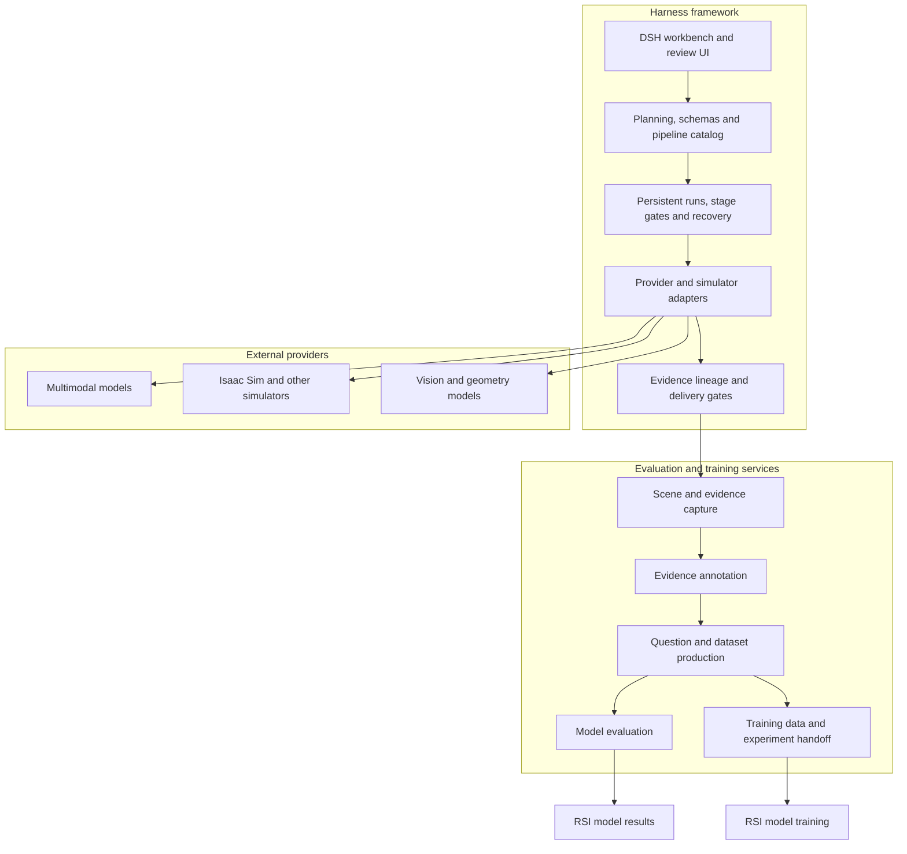

# BenchForgeV2

BenchForgeV2 develops a modular harness for spatial benchmark production and model evaluation. It supports two product lines: the framework that plans and runs evidence-backed workflows, and services that deliver evaluation or training data to RSI models. The official DSH source remains an external dependency.



The diagram shows the intended boundaries. Some adapters, scene capture, dataset production, evaluation, and local training utilities exist today; the roadmap below separates those from planned work.

## Current capabilities

- **Harness and workflows:** DSH plugin integration; a catalog of 89 tasks and 267 measurement templates; persistent pipelines that can resume; stage reviews; model and simulator adapters.
- **SpatialForge:** scene programs, asset generation, simulation queue, capture evidence, operator review, and public data export. See the [integration guide](integrations/spatialforge/README.md).
- **Evidence and delivery:** keep model-visible questions separate from authority answers; record source and capture evidence; validate declared public assets before packaging.
- **Evaluation and training:** deterministic local scoring, dataset packaging, spatial capability templates, and controlled training examples. These do not imply that a target RSI model has been evaluated or trained.

The task/template catalog and the separate spatial-learning capability graph serve different purposes. Model predictions are candidate annotations, not ground truth. Ground truth must be derived from an accepted official source, executable task, or simulator evidence.

## Architecture and roadmap

See [architecture and evolution](docs/ARCHITECTURE_AND_ROADMAP.zh-CN.md) for module boundaries, design rules, milestones, and staffing needs.

Near-term work prioritizes clear contracts, configuration ownership, resumable execution, delivery status, and a reproducible package. Follow-on work can add annotation review, evidence lineage, workflow orchestration, multimodal model iteration, performance work, and RSI evaluation/training services behind those boundaries.

## Quick start

Python 3.10+ can run an offline example without a model API, GPU, or simulator:

```bash
git clone https://github.com/EurecaMoment/BenchForgeV2.git
cd BenchForgeV2
python benchforge.py demo
```

For the controlled dataset example:

```bash
python -m pip install -e ".[production,research]"
python examples/production_demo.py --workspace runs/production
```

To attach SpatialForge tools to an existing DSH profile, follow [integration setup](integrations/README.md). To run the bundled service and a self-hosted desktop worker, use the [installation guide](docs/SPATIALFORGE_INSTALL.md). Neither path migrates or restarts an existing production deployment.

## Configuration

Start from the checked-in examples under `config/`. Copy an example to a matching ignored `*.local.json` file for machine-specific values. Keep credentials, local model paths, runtime databases, generated datasets, logs, and backups outside version control.

SpatialForge uses one server configuration as the source for its execution mode and scene policy. In `production` mode, a valid scene policy is required. The client and DSH plugin read the resolved service URL and credentials without changing the server's environment. See [configuration and deployment boundaries](docs/SPATIALFORGE_INSTALL.md).

The root `.gitignore` excludes local configuration and generated output. CI also checks tracked path names for private configuration and disposable artifacts; this is a repository hygiene check, not a content-based secret scan.

## Verification

Run the [portable verification steps](docs/VALIDATION.md) locally. CI covers Windows and Linux on Python 3.10 and 3.12, with additional SpatialForge tests on Python 3.12. A passing offline test does not certify live service availability, GPU throughput, simulator fidelity, or model quality. Those require acceptance on the named target system.

- [Pipeline catalog and evidence requirements](docs/pipelines.md)
- [Spatial learning and training utilities](docs/spatial-learning.md)
- [Model-service boundary](docs/MODEL_SERVICES.md)
- [Self-hosted SpatialForge installation](docs/SPATIALFORGE_INSTALL.md)
