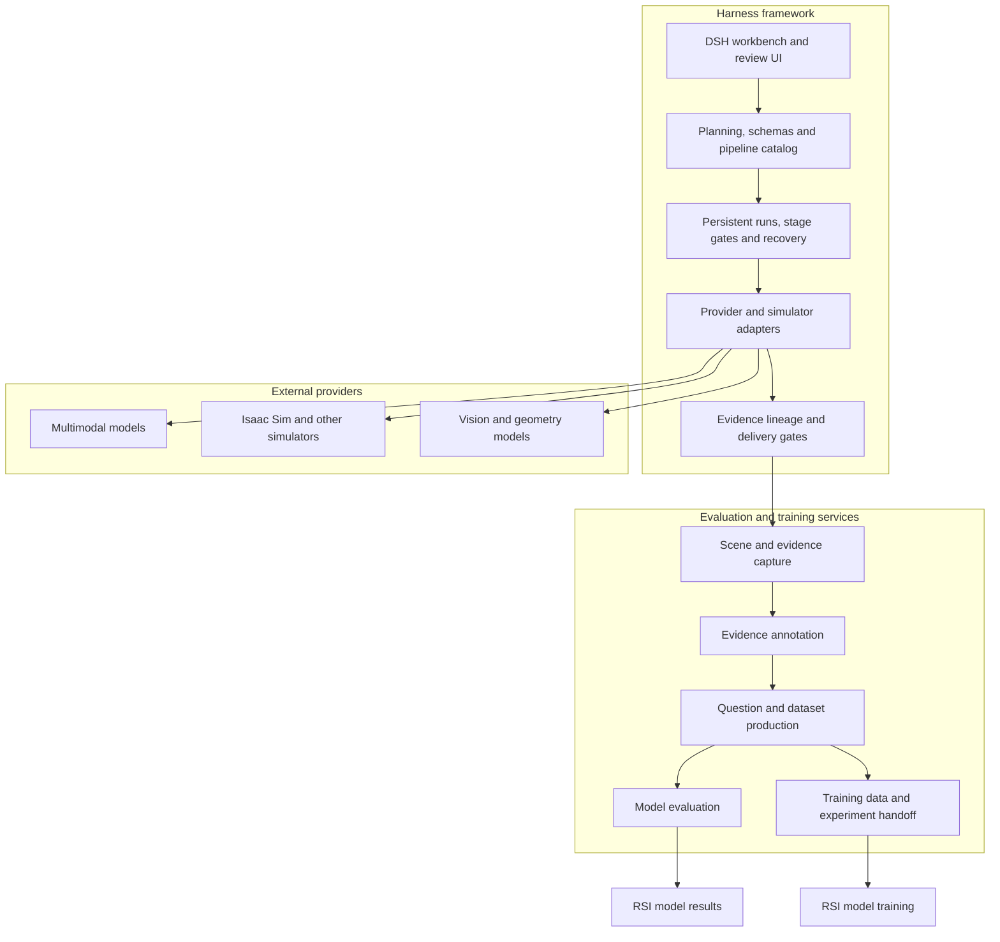

# BenchForgeV2

BenchForgeV2 develops a modular harness for spatial benchmark production and model evaluation. It supports two product lines: the framework that plans and runs evidence-backed workflows, and services that deliver evaluation or training data to RSI models. The official DSH source remains an external dependency.



The diagram shows the boundaries between the harness, external providers, and the evaluation and training services.

## 独立部署与两个 Agent 预设

下方提供 Linux 服务机的完整安装步骤，可在另一台机器或另一目录部署，
不需要已有 FIT 服务、旧 DSH 配置或其他分支的文件。按顺序执行
[独立部署指令](#独立部署指令linux)，先启动 Web、BenchForgeV2 和独立数据库。

本分支安装两个自定义 Agent 预设：

| 显示名称 | 用途 |
| --- | --- |
| **BenchForgeV2** | 场景和数据生产，使用标准对话界面 |
| **BenchForgeV2_UI** | 同一生产能力，附带评测生产工作台 |

UI 版沿用旧会话的内部 ID，已有会话继续关联自己的工作台和历史产物。
基础安装不需要 GPU、模型密钥或 Isaac。模型问答、图像生成和仿真采集需要另外配置对应服务。

## Current capabilities

- **Harness and workflows:** DSH plugin integration; a catalog of 89 tasks and 267 measurement templates; persistent pipelines that can resume; stage reviews; model and simulator adapters.
- **BenchForgeV2:** scene programs, asset generation, simulation queue, capture evidence, operator review, and public data export. See the [integration guide](integrations/spatialforge/README.md).
- **Evidence and delivery:** keep model-visible questions separate from authority answers; record source and capture evidence; validate declared public assets before packaging.
- **Evaluation and training:** deterministic local scoring, dataset packaging, spatial capability templates, and local training tools.

The task/template catalog and the separate spatial-learning capability graph serve different purposes. Model predictions are candidate annotations, not ground truth. Ground truth must be derived from an accepted official source, executable task, or simulator evidence.

## Third-party provider libraries

[`third_party/`](third_party/README.md) includes pinned Git submodules for
FastTrellis2, DSpark4A100, IssacSim4A100, FastSAM3, FastFLUX2Klein, and FastDA3.
After pulling this repository, download their sources with:

```bash
git submodule sync --recursive
git submodule update --init --recursive --depth 1
```

These providers are optional for the base installation. Follow each provider's
own README to install its environment, weights, and service.

## Configuration

Start from the checked-in examples under `config/`. Copy an example to a matching ignored `*.local.json` file for machine-specific values. Keep credentials, local model paths, runtime databases, generated datasets, logs, and backups outside version control.

BenchForgeV2 uses one server configuration as the source for its execution mode and scene policy. In `production` mode, a valid scene policy is required. The client and DSH plugin read the resolved service URL and credentials without changing the server's environment.

The root `.gitignore` excludes local configuration and generated output.

## Verification

CI covers Windows and Linux on Python 3.10 and 3.12, with extra SpatialForge checks on Python 3.12. Run `python -m unittest discover -s tests -v` to check the core.

## 独立部署指令（Linux）

以下命令在 **Linux 服务器的 Bash 终端**执行，只有第 6 节的 SSH 隧道在自己的
电脑上执行。每一组成功后再执行下一组；失败时先处理错误，避免拿半安装状态启动。
示例选择 Web `3092`、API `3858`、数据库 `55548`，可在第 3 节改成自己的空闲端口。

### 0. 准备运行环境

| 软件 | 要求 | 检查命令 |
| --- | --- | --- |
| Git | **2.26 或更新**，DSH 安装脚本有此要求 | `git --version` |
| Python | 完整部署用 3.11、3.12 或 3.13，并包含 venv/ensurepip | `python3.11 --version` |
| Node.js / npm | Node 22.19+ 或 24+；建议 24 LTS | `node --version`、`npm --version` |
| Docker Engine / Compose | 当前用户可使用 Docker；Compose v2 支持 `--wait` | `docker info`、`docker compose version` |
| 系统工具 | `bash`、`ss`、`curl`、`setsid`、C/C++ 编译工具 | `command -v bash ss curl setsid cc make` |
| bubblewrap | 执行隔离任务代码时使用；基础页面验收不调用它 | `command -v bwrap` |

本文统一用 `python3.11` 创建环境；已经安装 3.12/3.13 时，只需把下面创建环境的
`python3.11` 换成该命令，后续都使用 `.venv/bin/python`。系统的 `python3` 可能仍是
3.8，不要仅凭命令存在就继续。需要联网下载 GitHub 源码、npm/PyPI 包和 PostgreSQL 镜像。

**已有 Conda 时，推荐创建专用环境，避免修改其他项目的 Git、Node 或 Python：**

```bash
# 新终端找不到 conda 时，先加载自己安装位置的初始化脚本。
# Miniconda 默认位置：
source "$HOME/miniconda3/etc/profile.d/conda.sh"
# Miniforge 用户改用：source "$HOME/miniforge3/etc/profile.d/conda.sh"

conda create -n benchforge --override-channels -c conda-forge \
  --repodata-fn current_repodata.json python=3.11 nodejs=24 'git>=2.26' -y
conda activate benchforge
git --version
python3.11 --version
node --version
npm --version
```

如果长时间停在 `Collecting package metadata`，先按 Ctrl+C 结束这次创建，再用
[TUNA 的 conda-forge 镜像](https://mirrors.tuna.tsinghua.edu.cn/help/anaconda/) 重试。
下列命令只为本次创建选择镜像，不修改其他项目的全局 Conda 配置：

```bash
conda create -n benchforge --override-channels \
  -c https://mirrors.tuna.tsinghua.edu.cn/anaconda/cloud/conda-forge \
  --repodata-fn current_repodata.json python=3.11 nodejs=24 'git>=2.26' -y
conda activate benchforge
git --version
python3.11 --version
node --version
npm --version
```

若提示 `benchforge` 已存在，先激活并检查版本；已有环境符合要求时直接使用，
不符合时为新环境换一个名字，保留旧环境。

没有 Conda 可先按 [Miniforge 官方安装说明](https://github.com/conda-forge/miniforge#install)
安装，然后执行上述创建环境的命令；已有符合版本要求的工具可跳过创建环境。
再次登录服务器后，先 `conda activate benchforge`，再进入仓库目录。

Ubuntu/Debian 缺少系统工具时，管理员可执行：

```bash
sudo apt-get update
sudo apt-get install -y build-essential curl ca-certificates iproute2 util-linux bubblewrap
```

Docker 尚未安装时，按 [Docker 官方 Linux 安装说明](https://docs.docker.com/engine/install/)
选择系统，安装 Engine 和 Compose plugin。普通用户访问权限按
[安装后配置](https://docs.docker.com/engine/install/linux-postinstall/) 设置；
重新登录后确认下面两条命令成功，再继续。不要为了绕过权限问题用 sudo 运行整套 Python/DSH。

```bash
docker info
docker compose version
```

### 1. 下载当前分支到新目录

`benchforge-3092` 是示例部署的独立目录名；已有同名目录时换一个新名称。

```bash
cd "$HOME"
git -c http.version=HTTP/1.1 clone --branch simulator-access-integration --single-branch https://github.com/EurecaMoment/BenchForgeV2.git benchforge-3092
cd benchforge-3092
git branch --show-current
```

最后一行应输出 `simulator-access-integration`。之后所有服务器命令都在这个目录执行。
不要复制旧部署的 `config/`、`.benchforge/` 或 `.spatialforge/`。
`-c http.version=HTTP/1.1` 仅对本次克隆生效，用于减少部分网络链路上的 GitHub
连接中断，不修改全局 Git 配置。若下载仍失败，保留错误并检查网络；重试前确认目标
目录尚未创建，已有目录则换新名称，不要删除已有部署。

### 2. 安装 Python 后端与 Node 插件

```bash
python3.11 -m venv .venv
.venv/bin/python -m pip install -e '.[dsh,production,research]'
npm ci --prefix integrations
.venv/bin/python spatialforge_app.py setup
```

`.venv/` 是核心与 DSH 辅助程序环境，`.spatialforge/venv/` 是后端环境。
`npm ci --prefix integrations` 安装插件依赖，不能用 Python 安装替代。
这一步完成后还没有启动服务，也没有配置模型或仿真器。

### 3. 选择端口并生成本实例配置

先检查这三个端口；没有输出表示当前未被监听。如有输出，换三个空闲端口，并在
后面的初始化、启动和隧道命令中使用对应数值。不要停止别人占用端口的进程。

```bash
ss -ltnp | grep -E ':(3092|3858|55548)\b' || true
```

```bash
.venv/bin/python spatialforge_app.py init \
  --port 3858 --db-port 55548 --project benchforge-3092
```

`--project` 是本实例的数据库项目名，同机不同部署必须不同。它保存为
`config/generated/database.env` 的 `COMPOSE_PROJECT_NAME`，启动和停止会读取同一值；
无需每次再手动指定。不要设置指向其他实例的 `COMPOSE_PROJECT_NAME` 环境变量。

初始化会自动生成随机数据库密码及两种 token，并建立匹配的客户端、服务端与 worker
配置。重复 `init` 会保留已有端口、项目配置和凭据，不会按新参数覆盖；因此首次就应
选好端口。如果默认客户端文件丢失，重跑 `init` 可从已有服务端配置补齐。

端口统一收敛在 `config/ports.env`（`SPATIALFORGE_PORT`、`POSTGRES_PORT`、
`BENCHFORGE_WEB_PORT`）。文件存在时，`./start.sh` 启动前会执行
`spatialforge_app.py sync`，把端口写回 `config/generated/` 下的全部生成物
（服务端 `port`、`database_url`、worker 的 `url`/`ssh_forward`、`database.env`）。
之后改端口只需编辑 `config/ports.env` 并重跑 `./start.sh`；`init --port/--db-port`
只决定首次初始化写入的初始值。

| 文件 | 用途 | 基础启动是否需要手改 |
| --- | --- | --- |
| `config/ports.env` | **端口唯一权威来源**；`./start.sh` 启动前自动 sync 到生成物 | 改端口时 |
| `config/benchforge.local.json` | **所有模型的唯一配置入口**：模型地址、ID、角色、解释器/权重、请求默认值，以及 `isaac.grpc` | 用模型/仿真器时配置 |
| `config/generated/database.env` | 数据库密码、端口、独立项目名和连接地址 | 否 |
| `config/generated/spatialforge-server.local.json` | API 端口、数据库环境变量引用、产物目录、服务凭据、生产策略和 `isaac` 透传 | 否 |
| `config/generated/spatialforge.local.json` | 引用服务端配置，继承地址、operator token 和生产策略 | 否 |
| `config/generated/worker.local.json` | 引用服务端配置，另设本机 Isaac 路径、`isaac_grpc` 和 worker 参数 | 接入 worker 时配置 |
| `config/generated/benchforge.local.yml` | 两个 DSH 预设与工作台插件，由 `build_presets.py` 生成 | 否 |

`config/generated/` 下的文件都是自动产物，不要手改端口或凭据；服务端配置是唯一
连接信息来源，客户端和同机 worker 不重复保存 token 或端口。本地配置、虚拟环境、
日志、产物都已被 Git 忽略；不要将密码或 token 上传到仓库。
未使用 `--project` 的旧配置仍沿用 `benchforgev2-spatialforge` 项目名。

### 4. 安装 DSH 并生成完整预设

```bash
.venv/bin/python spatialforge_app.py dsh-setup
```

此命令从公开仓库下载锁定版本的 DSH，在 `third_party/deepseek-harness/` 构建，
然后生成 `config/benchforge.local.json`、含两个预设和工作台插件的
`config/generated/benchforge.local.yml` 与
`.benchforge/runtime.json`。首次源码构建可能需要数分钟，最后应看到
`Ready. Run: python benchforge.py start`，且命令退出码为 0。

这里必须使用 **`dsh-setup`**（或下方等价命令），它会将第 3 节的服务配置接入预设：

```bash
# 与上一条二选一，不需要重复执行。
.venv/bin/python benchforge.py setup --spatialforge-config config/generated/spatialforge.local.json
```

`benchforge.py setup` 默认使用本实例的 `config/generated/spatialforge.local.json`。
首次从旧版升级时重新执行 `dsh-setup` 以更新预设。已有手工模型配置时先备份本地 YAML。
DSH 本身默认通过锁定的 pnpm 版本安装；不需要复制另一部署的 DSH。

如果此步骤在下载 DSH 时出现 `unexpected eof`、`SSL_read` 或 `schannel` 连接错误，
先确认网络恢复。使用 Git 2.31+（上方推荐的 Conda 环境满足要求），可按下面的方式
重试，让本次安装调用的 Git 也使用 HTTP/1.1；这些环境变量只在该命令中生效：

```bash
GIT_CONFIG_COUNT=1 GIT_CONFIG_KEY_0=http.version GIT_CONFIG_VALUE_0=HTTP/1.1 \
  .venv/bin/python spatialforge_app.py dsh-setup
```

该命令仍从锁定的公开仓库版本安装，不需要手工复制 DSH 文件或改全局配置。

### 5. 启动本实例

```bash
BENCHFORGE_WEB_PORT=3092 ./start.sh
```

脚本依次启动本实例的 PostgreSQL、BenchForgeV2 和 DSH，日志及 PID 写入当前目录的
`.benchforge/`。成功时会打印带 token 的 Web 地址，例如：

```text
http://127.0.0.1:3092/?token=本次启动的实际令牌
```

后台服务与终端分离，安装成功后关闭 SSH 终端不会结束服务。
每次启动或重启都应显式写 `BENCHFORGE_WEB_PORT=3092`；省略时脚本使用 `3081`。
DSH 的会话和设置保存在当前目录 `.benchforge/dsh-home/`。

如果没有正常结束或没有新地址，先查看本实例日志；仅端口监听不能证明插件加载完成：

```bash
tail -n 40 .benchforge/logs/spatialforge.log
tail -n 60 .benchforge/logs/dsh.log
```

### 6. 在自己的电脑上打开网页

在**自己的电脑**新开终端，将 `your-user@your-server` 替换为服务器账号与地址
（也可使用已有 SSH 别名）：

```bash
ssh -N -o ExitOnForwardFailure=yes -L 13092:127.0.0.1:3092 your-user@your-server
```

此命令持续运行、不返回提示符是正常现象，保持终端打开。在浏览器中使用第 5 节
输出的完整 URL，把端口 `3092` 改为本地 `13092`，保留原 token：

```text
http://127.0.0.1:13092/?token=第5节输出的实际令牌
```

本地 `13092` 被占用时只改隧道左侧端口，并同步改浏览器 URL。
直接打开不带 token 的根地址可能返回 `dsh web authentication required`。
进入页面后，新建会话应能选择 **`BenchForgeV2` 和 `BenchForgeV2_UI`**。
选择 `BenchForgeV2_UI` 查看工作台；尚未配置模型时先不要发起生产任务。

### 7. 验收基础安装

回到**服务器的仓库目录**执行：

```bash
# 检查该实例的数据库容器，状态应为 healthy。
docker compose --env-file config/generated/database.env -f components/spatialforge/deploy/compose.yml ps

# 发起真实、带认证的 POST /catalog，不需要手动复制 token。
.venv/bin/python spatialforge_app.py status
.venv/bin/python integrations/spatialforge/cli.py status --config config/generated/spatialforge.local.json

```

两次目录查询应返回 `catalog_schema: spatialforge.operator-catalog/v2` 和 `sections`，
不应返回认证错误。`model: unconfigured` 表示还没有配置后端规划模型，基础安装允许此状态。
不要用普通 `GET /catalog` 的 HTTP 200 代替检查：GET 会返回介绍页，实际目录接口是 POST。

若端口被占用，编辑 `config/ports.env`（三个端口一处修改，原始端口可注释保留），
然后重跑 `./start.sh`——启动前的自动 `sync` 会把新端口同步到所有生成物。
DSH 端口也可临时用 `BENCHFORGE_WEB_PORT=3090 ./start.sh` 覆盖。

再确认网页能够登录、两个预设均可选，且 `BenchForgeV2_UI` 能显示工作台、没有加载错误。
页面验收必须新建并选择 **`BenchForgeV2_UI`** 会话、绑定本实例的独立工作区，确认
“评测计划、场景预览、标注预览、评测配置与题目表、最终报告”五个阶段可以打开。
只看到 DSH 默认 Standard 对话页面，不能算工作台安装成功。新实例应显示空的生产状态，
不应读取其他实例的历史任务；原有样板对话在各自实例中继续保留原工作区和产物关联。
这些结果验证基础部署；Isaac 画面、生成模型质量和真实生产吞吐需要分别验收。

### 8. 配置自己需要的模型和仿真能力

所有模型统一在 **`config/benchforge.local.json`** 声明，初始化时从
[`config/benchforge.example.json`](config/benchforge.example.json) 创建。
不要再新建或编辑 `config/generated/models.local.json`，也不要在服务端 JSON 或预设 YAML
中重复维护模型地址。

- **DSH 对话、自动规划、独立标注接口的模型**：在 `models` 声明地址、模型 ID 和密钥环境变量名，
  再让 `model_roles.dsh/scene/annotation` 引用它；使用不同模型时分别声明和引用。
- **图像、分割、深度、三维模型**：`services` 保存原生标注接口，
  `model_services` 保存异步推理网关及各工具默认参数，
  `models` 和 `sources` 保存可选本地执行所需的解释器、权重和源码路径。
  `generation.mode=remote` 使用网关，`local` 使用本地已安装模型。
  地址和路径示例不代表相应服务、权重或依赖已经可用。
- **Isaac 真值与采集**：在 `config/benchforge.local.json` 设置 `isaac.grpc`，运行 `spatialforge_app.py sync`，
  然后在 worker 机器上执行 `python spatialforge_app.py worker --config <worker-config>`。
  worker 配置可从 `config/generated/worker.local.json` 复制，再填写该机器可用的服务地址、令牌和目录。
- **场景工作台 UI**：选择 `BenchForgeV2_UI` 打开评测工作台，`BenchForgeV2` 使用标准对话界面。

模型凭据存放在被忽略的 `config/dsh.env` 中，以统一 JSON 里的 `token_env` 引用；
`start.sh` 会在启动后端和 DSH 前加载，`spatialforge_app.py serve` 也会加载此文件。
不要把密钥值写进示例或提交 GitHub。

编辑统一配置后，在本实例执行：

```bash
.venv/bin/python spatialforge_app.py sync
BENCHFORGE_WEB_PORT=3092 ./restart.sh
```

`sync` 首次执行会把旧的模型路径和服务端模型字段补入统一文件，已有统一字段优先，
旧文件保留；服务端改为引用统一文件。DSH 启动时自动刷新模型配置快照，不重建预设或改写
已有会话。占位模型不会覆盖 DSH 默认模型；填写实际模型后，新会话默认使用 `model_roles.dsh`。

### 9. 停止、重启和更新

以下命令仍在**本实例目录**执行，已安装的运行环境应处于激活状态：

```bash
# 修改本地配置后，保留数据库并重启应用。
BENCHFORGE_WEB_PORT=3092 ./restart.sh

# 只停止应用，保留数据库运行。
BENCHFORGE_WEB_PORT=3092 ./shutdown.sh --keep-db

# 停止本实例全部服务；数据库数据卷仍然保留。
BENCHFORGE_WEB_PORT=3092 ./shutdown.sh
```

更新 `simulator-access-integration` 时，先保留本地配置和数据，再停止应用、拉取代码和更新依赖。

```bash
BENCHFORGE_WEB_PORT=3092 ./shutdown.sh --keep-db
git pull --ff-only origin simulator-access-integration
.venv/bin/python -m pip install -e '.[dsh,production,research]'
npm ci --prefix integrations
.venv/bin/python spatialforge_app.py setup
BENCHFORGE_WEB_PORT=3092 ./start.sh
```

除非确实需要重新生成预设，否则不要再次运行 `dsh-setup` 覆盖自己的模型配置。
需要重新生成时先备份 `config/generated/benchforge.local.yml`，生成后合回自己的追加项。
不要通过复制另一套实例的配置来升级，也不要删除 `.spatialforge/` 或数据库卷。

### 10. 常见失败及处理

| 现象 | 原因与处理 |
| --- | --- |
| `Git 2.26 or newer is required` | 当前终端仍使用旧 Git。执行第 0 节环境激活与版本检查，确认 `git --version` 后重跑第 4 节。不要跳过官方安装检查。 |
| `Python 3.10+ is required` / `BenchForgeV2 requires Python 3.11` | 选择了旧系统 Python；按第 0 节准备 3.11，再创建 `.venv`。 |
| `venv` / `ensurepip` 缺失 | Conda 路线包含所需组件；系统 Python 路线需安装对应版本的 venv 包，例如 `python3.11-venv`。 |
| Docker `permission denied` / daemon 不可用 | 完成 Docker 官方安装后配置并重新登录，先让 `docker info` 成功。 |
| 端口占用 | 新部署在初始化前换空闲端口和独立 `--project`；不要让启动脚本误认其他实例的监听端口。 |
| `spatialforge-tools` 的配置文件 `ENOENT` | 先执行第 3 节，再执行第 4 节；文件搬过位置时，修改生成预设里 `serviceConfig` 的实际路径。重跑 `init` 只补齐默认缺失客户端。 |
| `Cannot find module '@deepseek-ai/...'` | 在仓库执行 `npm ci --prefix integrations`，然后重启当前实例。 |
| token 无效 / `dsh web authentication required` | 使用当前进程的新 URL；通过隧道时只替换端口，保留完整 token。 |
| 端口已监听却没有新 token | 查看 `.benchforge/logs/dsh.log` 的真实错误；并非所有情况都是 inotify 问题。 |
| 明确出现 `ENOSPC: file watchers` | 主机文件监视器配额耗尽；可请管理员提高 inotify 配额，或按下方方法在当前实例关闭配置热更新。 |
| 页面无可用模型 / 模型请求失败 | 完成第 8 节，核对提供方、模型 ID、地址与凭据；页面能打开不代表模型已配置。 |

关闭当前实例的配置热更新：在 **`config/generated/benchforge.local.yml` 的顶层列表末尾**追加
以下条目，然后执行第 9 节的重启命令。这是可选修复，生成预设时不会自动追加：

```yaml
- id: hmr
  disabled: true
```

追加前可备份：`cp config/generated/benchforge.local.yml config/generated/benchforge.local.yml.bak-before-hmr`。
禁用后，每次修改配置需重启；重新生成预设也需重新保留这条覆盖。

## 已有后端时的连接方式

这条路线适用于**明确要复用既有服务**的人，独立部署请使用上面的第 0–7 节。
同机复用时，复制客户端示例，将 `service_config` 改为既有服务端 JSON 的实际路径；
地址、operator token 和生产策略从该文件继承，再验证连接和生成预设：

```bash
cp config/spatialforge.example.json config/generated/spatialforge.local.json
# 用编辑器将 service_config 改为既有服务端配置的路径后继续。
.venv/bin/python integrations/spatialforge/cli.py status --config config/generated/spatialforge.local.json
.venv/bin/python benchforge.py setup --spatialforge-config config/generated/spatialforge.local.json
.venv/bin/python benchforge.py start --port 3092 --no-open
```

跨机器连接时，可改用独立客户端 JSON，移除 `service_config`，填写 `service_url`、
`operator_token_env`、`execution_mode` 和本机可读的 `scene_policy_path`；生产模式必须提供
与后端一致的有效策略文件。将 token 注入指定环境变量后再执行上述验证与启动。

这条路线不使用 `start.sh` 创建另一数据库。已构建 DSH 可额外传入
`--dsh-root /path/to/deepseek-harness`；新手独立安装无需此选项。

## 开发检查

以下是开发者修改代码后的检查，不是部署者必须跑完的安装步骤：

```bash
.venv/bin/python -m unittest discover -s integrations/tests -v
.venv/bin/python integrations/spatialforge/smoke.py
```
