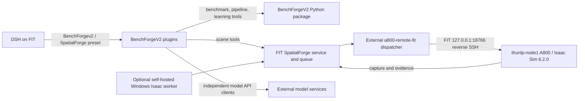

# BenchForgeV2

BenchForgeV2 is the maintained repository for the second-generation DSH mode,
SpatialForge integrations, composable benchmark pipelines, and spatial-learning
tools. New integration work belongs here; the official `deepseek-harness` source
is an external dependency and is not modified by this repository.

## Modes and deployment

The DSH preset names identify separate modes in the same deployment:

| Mode | Purpose | DSH profile binding |
| --- | --- | --- |
| `BenchForge` | Retained first-generation benchmark mode | Legacy mode |
| `BenchForgev2` | Second-generation published mode | `.deployment/published` on FIT |
| `SpatialForge` | Second-generation development mode with scene tools | Repository checkout on FIT |

The maintained FIT checkout is `/home/maqiang/GitHub/BenchForgeV2`, branch
`SpatialForge`; the public repository is
[EurecaMoment/BenchForgeV2](https://github.com/EurecaMoment/BenchForgeV2).
The active production simulation route is DSH on FIT → the FIT SpatialForge
service and queue → the external `a800-remote-fit` dispatcher → FIT's local
reverse-SSH endpoint `127.0.0.1:18766` → `thunlp-node1` running Isaac Sim 6.2.0
on A800 → capture and evidence returned to FIT. `desktop-isaac` is a retained
database lease name; it does not identify the active remote worker. The A800
dispatcher and its server-side Isaac deployment are outside this repository.



The Windows worker is a supported self-hosted deployment option, not the active
FIT production route. External model services, weights, simulator installations,
assets, credentials, and production artifacts remain in their own deployment
locations. The lightweight clients in this repository do not start or migrate
those services.

## What is included

- **Composable pipelines:** retrieve 89 user-defined tasks and 267 exact
  measurement-template variants from the 出题模板; interpret an objective into
  explicit template selections; run, resume, inspect and deterministically
  evaluate pipeline artifacts. Only 17 variants currently have built-in
  program generators. Other variants require official, program, or simulation
  evidence and task-specific adapters before they become production data.
- **Spatial learning:** a separate graph of 27 capability nodes, each with 120
  template specifications, plus program-grounded dataset generation, curriculum
  training, experiments, checkpointing and live training monitoring. See
  [Spatial learning](docs/spatial-learning.md).
- **SpatialForge:** reference/layout tools, scene programs, assets, model-service
  clients, capture/evidence review and data export. See the
  [SpatialForge integration guide](integrations/spatialforge/README.md).
- **DSH integration:** installable Node plugin bundles and preset builders. DSH
  source, external model startup code, model weights and simulator deployment
  are not vendored as BenchForgeV2 runtime services.

The capability graph and the 出题模板 catalog are different resources: the
27-node graph is not a relabeling of the 89-task/267-template catalog. Generated
records keep public questions separate from authority data; model predictions
do not become ground truth. Ground truth comes from official sources, task
programs or simulation.

## Local examples

Python 3.10+ can run the offline benchmark example without a model API or GPU:

```bash
git clone https://github.com/EurecaMoment/BenchForgeV2.git
cd BenchForgeV2
python benchforge.py demo
```

For a programmatic production example:

```bash
python -m pip install -e ".[production,research]"
python examples/production_demo.py --workspace runs/production
```

This draws and scores a small set of controlled examples. It is not an Isaac
scene-quality, model-training, or benchmark-approval result. The CPU learning
demo trains only a small controlled Transformer task:

```bash
python examples/spatial_learning_demo.py --workspace runs/cpu-training
```

## DSH setup


已有 SpatialForge 后端和桌面 worker 时，复制
`config/spatialforge.example.json` 为 `config/spatialforge.local.json`，
填写服务 URL 与 `operator_token`，然后执行：

```bash
python integrations/spatialforge/cli.py status --config config/spatialforge.local.json
python benchforge.py setup --spatialforge-config config/spatialforge.local.json

The simple launcher below builds a private DSH runtime and installs the retained
first-generation `BenchForge` mode for local use. It does not reproduce FIT's
current SpatialForge/A800 deployment:

```bash
python benchforge.py setup

python benchforge.py start
```

To attach the second-generation bundle to an existing DSH profile, follow
[integration installation and preset selection](integrations/README.md). To run
the bundled SpatialForge server and a self-hosted desktop worker, use the
[self-hosted installation guide](docs/SPATIALFORGE_INSTALL.md); it is an
alternative deployment, not a migration recipe for FIT's A800 worker.


## 全流程启动（数据库 + SpatialForge + DSH）

仓库提供三个一键脚本，配置只读取本仓库的 `config/`，不需要设置任何配置类环境变量：

| 脚本 | 作用 |
|---|---|
| `./start.sh` | 启动 PostgreSQL → SpatialForge（3856）→ DSH Web（3081） |
| `./restart.sh` | 保留数据库，重启 SpatialForge 与 DSH |
| `./shutdown.sh` | 逆序停止全部；`--keep-db` 只停应用 |

示例端口：SpatialForge `3856`、PostgreSQL `55546`、DSH `3081`。`start.sh` 按
`config/spatialforge-server.local.json` 的 `port` 启动服务，Web 端口可用
`BENCHFORGE_WEB_PORT` 覆盖。

### 1. 首次准备（只做一次）

```bash
python3.11 -m venv .venv
.venv/bin/python -m pip install -e ".[dsh,production,research]"
npm ci --prefix integrations

python3.11 spatialforge_app.py setup
.venv/bin/python spatialforge_app.py init --port 3856 --db-port 55546
```

`npm ci --prefix integrations` 不能省略：DSH 插件以裸包名导入
`@deepseek-ai/dsh-tools` 等模块，缺少该目录时插件无法加载。DSH 本身可用
`python benchforge.py setup` 安装，或用
`python benchforge.py setup --dsh-root /path/to/deepseek-harness` 复用已构建的 DSH。

`init` 仅在 `config/spatialforge-server.local.json` 不存在时执行，会生成
`config/database.env`（随机密码、权限 600）、客户端配置、`models.local.json` 与
`worker.local.json`。之后 `./start.sh` 直接复用这些文件。

### 2. 配置文件

| 文件 | 关键字段 | 说明 |
|---|---|---|
| `config/benchforge.local.json` | `services.*`、`models.qwen`、`model_services.url` | 外部模型地址；`model_services` 默认复用 4960 网关 |
| `config/benchforge.local.yml` | `llm-pi-ai`、`agent-default-model`、`hmr` | DSH 预设；由 `build_preset.py` 生成，末尾追加了本项目覆盖项 |
| `config/dsh.env` | `QWEN_RELAY_API_KEY` | DSH 调用本地 Qwen 中转的 key |
| `config/spatialforge.local.json` | `service_url`、`operator_token` | 客户端视角 |
| `config/spatialforge-server.local.json` | `port`、`database_url`、`artifacts`、`harness`、`model_url`、`models_config` | 服务端视角 |
| `config/database.env` | `POSTGRES_PORT` | PostgreSQL 宿主机端口；密码由 init 生成，不要手改 |
| `config/worker.local.json` | `url`、`worker_token` | Windows 采集 worker |
| `config/models.local.json` | 解释器与权重路径 | 本地模型 |

必须保持一致的项：

- `spatialforge-server.local.json` 的 `port` = `spatialforge.local.json` 的
  `service_url` 端口 = `worker.local.json` 的 `url` 端口。
- 客户端与服务器端的 `operator_token` 相同；服务器端与 worker 的
  `worker_token` 相同。
- `database.env` 的 `POSTGRES_PORT` = 服务端 `database_url` 中的端口。

### 3. 模型提供方（本项目已配置）

`config/benchforge.local.yml` 由 `build_preset.py` 生成，末尾追加了本项目覆盖项：

- `hmr: disabled`：本机 inotify 配额已满，关闭文件热更新，避免 DSH 卡在启动阶段。
- `llm-pi-ai` 的 `qwen-flash`：`baseURL: http://127.0.0.1:29002/v1`，模型
  `Qwen/Qwen3.8-Flash-Next`，key 由 `config/dsh.env` 的 `QWEN_RELAY_API_KEY` 注入。
- `agent-default-model`：新会话默认使用 `qwen-flash`。

因此 DSH 不再要求 DeepSeek 官方 API Key。旧会话会保留创建时的模型选择，需要在
会话底部的模型选择器切到 Qwen；新会话默认即为 Qwen。

重新执行 `build_preset.py` 会覆盖这些追加项，建议先备份为
`config/benchforge.local.yml.bak-<日期>`，生成后再把追加项补回。由于已禁用 hmr，
修改任何配置后都需要执行 `./restart.sh`。

### 4. 一键启动

```bash
./start.sh
```

脚本行为：

- 幂等：已在监听的服务会跳过，不会重复启动。
- 用 `setsid` 脱离终端，关闭终端后服务继续运行。
- 等待数据库 healthy、服务与 DSH 就绪；失败时打印日志尾部并以非 0 退出。
- 只认本次启动新产生的 token；180 秒内拿不到会提示 inotify 配额问题，并结束卡住的 DSH。
- 日志：`.benchforge/logs/spatialforge.log`、`.benchforge/logs/dsh.log`
- PID：`.benchforge/run/*.pid`

### 5. 访问 DSH Web

服务器本机直接打开 `start.sh` 打印的地址：

```
http://127.0.0.1:3081/?token=...
```

本地电脑需要 SSH 隧道（本地 `3081` 被占用时换成 `18081`）：

```bash
ssh -N -L 18081:127.0.0.1:3081 <server-alias>
```

然后访问 `http://127.0.0.1:18081/?token=...`。直接打开根路径会返回
`dsh web authentication required`，必须带 token。进入后新建会话选择
**BenchForgeV2**，即可使用 `benchforge-tools` 与 `spatialforge-tools`。

### 6. 启动后检查

```bash
.venv/bin/python spatialforge_app.py status      # 数据库 + 服务 + 认证
.venv/bin/python benchforge.py demo              # 不依赖模型与 GPU 的离线链路
curl -s -o /dev/null -w '%{http_code}\n' http://127.0.0.1:3856/catalog -H "Authorization: Bearer <operator_token>"
```

模型能力还需外部服务：4960 网关（`model_services`）、29002 Qwen（`models.qwen`）、
8765/8766/8008（SAM3/YOLOE/DepthAnything，按需启动）。网关可用时
`sam3d` 应返回就绪；`lama`/`flux` 返回 502 表示其上游 worker 未启动，与本仓库配置无关。

### 7. 端口冲突处理

```bash
ss -ltnp | grep -E ':(3856|55546|3081)\b'
```

若端口被占用，按组件修改后重启：

- SpatialForge：改 `spatialforge-server.local.json` 的 `port`，同步修改
  `spatialforge.local.json` 的 `service_url` 与 `worker.local.json` 的 `url`。
- PostgreSQL：改 `database.env` 的 `POSTGRES_PORT`，同步修改服务端
  `database_url` 端口，然后重新执行 `spatialforge_app.py db`。
- DSH：`BENCHFORGE_WEB_PORT=3090 ./start.sh`，或手动
  `benchforge.py start --port <端口>`。

本机若已有现网服务，常见占用为：`3841`（另一套 SpatialForge）、`4960`（共享模型
网关，应当复用）、`29002`（Qwen）、`3080`（另一套 DSH）、`32768`（旧 harness 的
PostgreSQL）。这也是示例配置使用 `3856`/`55546`/`3081` 的原因。

### 8. 停止与重启

```bash
./shutdown.sh             # 停止应用与数据库，保留数据卷
./shutdown.sh --keep-db   # 只停两个应用
./restart.sh              # 保留数据库，重启两个应用
```

`shutdown.sh` 使用 `docker compose down`（不带 `-v`），只删除容器与网络，数据卷保留。

### 9. 常见问题

- DSH 端口已监听但没有新 token，或日志出现 `ENOSPC: file watchers`：inotify 配额
  耗尽。能 sudo 时提高 `fs.inotify.max_user_watches`；不能时本项目已通过
  `hmr: disabled` 规避，改配置后执行 `./restart.sh`。
- 打开旧 token 地址报 `dsh web authentication required`：DSH 每次启动都会换 token，
  使用 `start.sh` 本次输出的地址。
- 插件加载报 `Cannot find module '@deepseek-ai/...'`：执行
  `npm ci --prefix integrations` 后重启 DSH。
- 页面模型仍显示 DeepSeek：旧会话保留历史选择，新建会话或在模型选择器里切到
  Qwen；若新会话仍如此，检查 `config/benchforge.local.yml` 的 `agent-default-model`。
- `config/benchforge.local.yml` 是“生成物 + 追加覆盖”，重新生成后需要把追加项补回。

## 验证与文档

```bash
python -m unittest discover -s tests -v
python integrations/spatialforge/smoke.py
```

The SpatialForge smoke test checks its HTTP request contract and delivery-review
logic without starting Isaac or calling a target-model API. A passing local test
does not establish current remote service health.

- [Pipeline catalog and evidence requirements](docs/pipelines.md)
- [Spatial learning, training and monitoring](docs/spatial-learning.md)
- [Model-service client boundary](docs/MODEL_SERVICES.md)
- [Self-hosted SpatialForge install](docs/SPATIALFORGE_INSTALL.md)
- [Validation scope and history](docs/VALIDATION.md)
