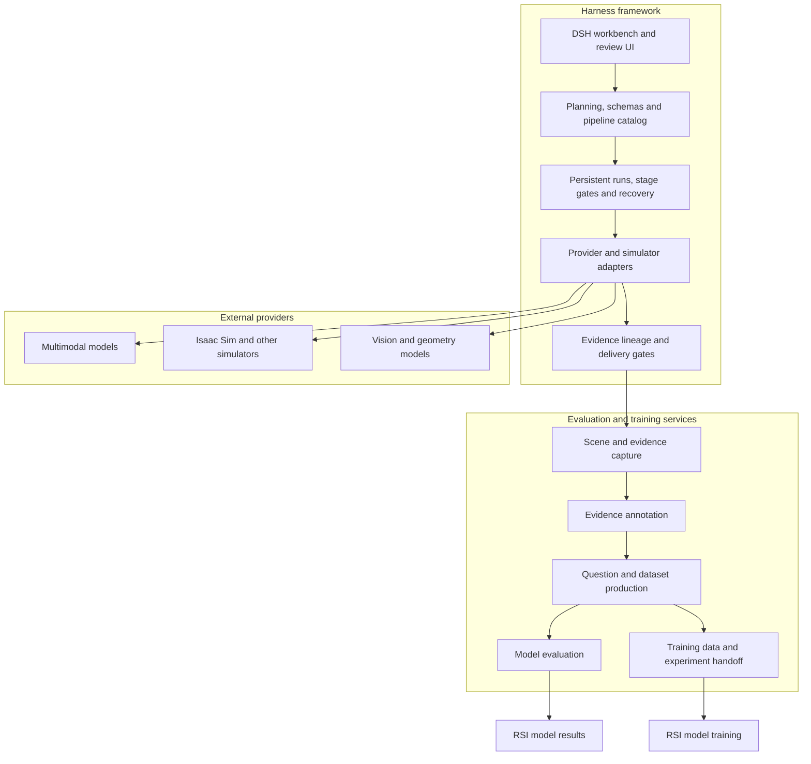

# BenchForge

BenchForge develops a modular harness for spatial benchmark production and model evaluation. It supports two product lines: the framework that plans and runs evidence-backed workflows, and services that deliver evaluation or training data to RSI models. DSH is supplied by the pinned `deepseek-harness4BenchForge` submodule.



## 源码目录

| 目录 | 职责 |
| --- | --- |
| [`src/benchforge_core/`](src/benchforge_core/) | Python 核心，负责评测计划、流水线恢复、证据、出题、评分和训练数据。 |
| [`src/backend/`](src/backend/) | 场景生产后端、任务队列、模型适配、Isaac gRPC、桌面采集和部署工具。 |
| [`src/dsh/presets/`](src/dsh/presets/) | 装配 Agent 预设和 Host 插件，生成部署配置。 |
| [`src/dsh/tools/`](src/dsh/tools/) | Agent 工具、执行器和预设作用域策略。 |
| [`src/dsh/host/`](src/dsh/host/) | 采集观察、会话操作和工作台 Gateway 接口。 |
| [`src/dsh/ui/`](src/dsh/ui/) | Web Client 和浏览器构建入口。 |

`config/` 提供部署配置，`third_party/` 提供固定版本的外部模型和仿真源码。

## 独立部署与两个 Agent 预设

下方提供 Linux 服务机的完整安装步骤，可在另一台机器或另一目录部署，
不需要已有 FIT 服务、旧 DSH 配置或其他分支的文件。按顺序执行
[独立部署指令](#独立部署指令linux)，先启动 Web、BenchForge 和独立数据库。

本分支安装两个自定义 Agent 预设：

| 显示名称 | 用途 |
| --- | --- |
| **BenchForge** | 场景和数据生产，使用标准对话界面 |
| **BenchForge_UI** | 同一生产能力，附带评测生产工作台 |

UI 版沿用旧会话的内部 ID，已有会话继续关联自己的工作台和历史产物。
基础安装不需要 GPU、模型密钥或 Isaac。模型问答、图像生成和仿真采集需要另外配置对应服务。

## Current capabilities

- **Harness and workflows:** DSH plugin integration; a catalog of 89 tasks and 267 measurement templates; persistent pipelines that can resume; stage reviews; model and simulator adapters.
- **BenchForge:** scene programs, asset generation, simulation queue, capture evidence, operator review, and public data export. See the [integration guide](src/dsh/README.md).
- **Evidence and delivery:** keep model-visible questions separate from authority answers; record source and capture evidence; validate declared public assets before packaging.
- **Evaluation and training:** deterministic local scoring, dataset packaging, spatial capability templates, and local training tools.

The task/template catalog and the separate spatial-learning capability graph serve different purposes. Model predictions are candidate annotations, not ground truth. Ground truth must be derived from an accepted official source, executable task, or simulator evidence.

## Third-party provider libraries

[`third_party/`](third_party/README.md) includes pinned Git submodules for
the DSH runtime, FastTrellis2, DSpark4A100, IssacSim4A100, FastSAM3, FastFLUX2Klein, FastDA3, and FastQwen.
After pulling this repository, download their sources with:

```bash
git submodule sync --recursive
git submodule update --init --recursive --depth 1
```

These providers are optional for the base installation. Follow each provider's
own README to install its environment, weights, and service.

## Configuration

`config/benchforge.example.json` is the configuration template. `benchforge_app.py init` creates the private `config/benchforge.local.json`. Set ports, paths, models, the database, and worker connections in that file. `benchforge_app.py sync` generates the runtime files used by BenchForge, DSH, and Compose.

BenchForge uses one server configuration as the source for its execution mode and scene policy. In `production` mode, a valid scene policy is required. The client and DSH plugin read the resolved service URL and credentials without changing the server's environment.

The root `.gitignore` excludes local configuration and generated output.

## Verification

CI checks installation and integration on Windows and Linux with Python 3.10 and 3.12, and runs additional backend checks on Python 3.12.

## 独立部署指令（Linux）

以下命令在 **Linux 服务器的 Bash 终端**执行，只有第 6 节的 SSH 隧道在自己的
电脑上执行。每一组成功后再执行下一组；失败时先处理错误，避免拿半安装状态启动。
示例选择 Web `3092`、API `3858`、数据库 `55548`，可在第 3 节改成自己的空闲端口。

### 0. 准备运行环境

| 软件 | 要求 | 检查命令 |
| --- | --- | --- |
| Git | **2.26 或更新**，DSH 安装脚本有此要求 | `git --version` |
| Python | 完整部署用 3.11、3.12 或 3.13，并包含 venv/ensurepip | `python3.11 --version` |
| Node.js / npm | Node 24.9 或更新 | `node --version`、`npm --version` |
| Docker Engine / Compose | 当前用户可使用 Docker；Compose v2 支持 `--wait` | `docker info`、`docker compose version` |
| 系统工具 | `bash`、`ss`、`curl`、`setsid`、C/C++ 编译工具 | `command -v bash ss curl setsid cc make` |
| bubblewrap | 执行隔离任务代码时使用；基础页面验收不调用它 | `command -v bwrap` |

本文统一用 `python3.11` 创建环境；已经安装 3.12/3.13 时，只需把下面创建环境的
`python3.11` 换成该命令，后续都使用 `.venv/bin/python`。系统的 `python3` 可能仍是
3.8，不要仅凭命令存在就继续。需要联网下载 GitHub 源码、npm/PyPI 包和 PostgreSQL 镜像。

**已有 Conda 时，推荐创建专用环境，避免修改其他项目的 Git、Node 或 Python：**

```bash
# 新终端找不到 conda 时，先加载自己安装位置的初始化脚本。
# Miniconda 默认位置：
source "$HOME/miniconda3/etc/profile.d/conda.sh"
# Miniforge 用户改用：source "$HOME/miniforge3/etc/profile.d/conda.sh"

conda create -n benchforge --override-channels -c conda-forge \
  --repodata-fn current_repodata.json python=3.11 nodejs=24 'git>=2.26' -y
conda activate benchforge
git --version
python3.11 --version
node --version
npm --version
```

如果长时间停在 `Collecting package metadata`，先按 Ctrl+C 结束这次创建，再用
[TUNA 的 conda-forge 镜像](https://mirrors.tuna.tsinghua.edu.cn/help/anaconda/) 重试。
下列命令只为本次创建选择镜像，不修改其他项目的全局 Conda 配置：

```bash
conda create -n benchforge --override-channels \
  -c https://mirrors.tuna.tsinghua.edu.cn/anaconda/cloud/conda-forge \
  --repodata-fn current_repodata.json python=3.11 nodejs=24 'git>=2.26' -y
conda activate benchforge
git --version
python3.11 --version
node --version
npm --version
```

若提示 `benchforge` 已存在，先激活并检查版本；已有环境符合要求时直接使用，
不符合时为新环境换一个名字，保留旧环境。

没有 Conda 可先按 [Miniforge 官方安装说明](https://github.com/conda-forge/miniforge#install)
安装，然后执行上述创建环境的命令；已有符合版本要求的工具可跳过创建环境。
再次登录服务器后，先 `conda activate benchforge`，再进入仓库目录。

Ubuntu/Debian 缺少系统工具时，管理员可执行：

```bash
sudo apt-get update
sudo apt-get install -y build-essential curl ca-certificates iproute2 util-linux bubblewrap
```

Docker 尚未安装时，按 [Docker 官方 Linux 安装说明](https://docs.docker.com/engine/install/)
选择系统，安装 Engine 和 Compose plugin。普通用户访问权限按
[安装后配置](https://docs.docker.com/engine/install/linux-postinstall/) 设置；
重新登录后确认下面两条命令成功，再继续。不要为了绕过权限问题用 sudo 运行整套 Python/DSH。

```bash
docker info
docker compose version
```

### 1. 下载当前分支到新目录

`benchforge-3092` 是示例部署的独立目录名；已有同名目录时换一个新名称。

```bash
cd "$HOME"
git -c http.version=HTTP/1.1 clone --branch simulator-access-integration --single-branch https://github.com/EurecaMoment/BenchForgeV2.git benchforge-3092
cd benchforge-3092
git branch --show-current
```

最后一行应输出 `simulator-access-integration`。之后所有服务器命令都在这个目录执行。
不要复制旧部署的 `config/`、`.benchforge/` 或 `.benchforge/backend/`。
`-c http.version=HTTP/1.1` 仅对本次克隆生效，用于减少部分网络链路上的 GitHub
连接中断，不修改全局 Git 配置。若下载仍失败，保留错误并检查网络；重试前确认目标
目录尚未创建，已有目录则换新名称，不要删除已有部署。

### 2. 安装 Python 后端与 Node 插件

```bash
python3.11 -m venv .venv
.venv/bin/python -m pip install -e '.[dsh,production,research]'
npm ci --prefix src/dsh
.venv/bin/python benchforge_app.py setup
```

`.venv/` 是核心与 DSH 辅助程序环境，`.benchforge/backend/venv/` 是后端环境。
`npm ci --prefix src/dsh` 安装插件依赖，不能用 Python 安装替代。
这一步完成后还没有启动服务，也没有配置模型或仿真器。

### 3. 初始化本实例配置

先检查这三个端口；没有输出表示当前未被监听。如有输出，换三个空闲端口，并在
后面的初始化、启动和隧道命令中使用对应数值。不要停止别人占用端口的进程。

```bash
ss -ltnp | grep -E ':(3092|3858|55548)\b' || true
```

```bash
.venv/bin/python benchforge_app.py init \
  --web-port 3092 --port 3858 --db-port 55548 --project benchforge-3092
```

之后只编辑 **`config/benchforge.local.json`**。同机部署多套实例时，每套使用独立的
`database.project` 和端口。重复执行 `init` 会使用本机文件中的既有配置。

| 配置键 | 用途 |
| --- | --- |
| `dsh` | 从配置模板同步的 DSH fork、子模块路径、版本和构建要求。实际提交由 Git 子模块指针锁定。 |
| `web.port` | DSH Web 端口。可用 `BENCHFORGE_WEB_PORT` 临时覆盖。 |
| `web.default_workspace` | DSH 的默认工作区目录。支持绝对路径和相对配置文件目录的路径。启动时创建或复用目录并登记工作区。值为 `null` 时沿用 DSH 的默认行为。 |
| `server` | 本机 BenchForge API 端口、对客户端公开的服务地址、产物目录、场景策略和认证环境变量名。 |
| `database` | PostgreSQL 端口、Compose 项目名和密码环境变量名。复用外部数据库时设置 `url` 或 `url_env`。 |
| `client` | DSH 和 CLI 连接的 BenchForge 后端。默认使用本机服务，亦可填 `service_config` 或 `service_url`。 |
| `worker` | 采集进程的身份、运行目录和连接设置。 |
| `providers` | 六个 `third_party/` 提供方。包括 DSpark 对话模型、四个推理工具和 Isaac gRPC。 |
| `inference` | 工具调用和场景生产共用的 BenchForge 推理网关地址与凭据环境变量名。 |

`init` 和 `sync` 生成 `config/generated/` 下的服务端、客户端、worker 和 Compose 配置。
`dsh-setup` 生成 DSH 预设。配置中的相对路径以 `config/benchforge.local.json` 所在目录为基准。
例如将 `web.default_workspace` 设为 `../workspaces/benchforge`，重启后 Web 在没有已选工作区时使用该目录。
模型密钥通过各字段指定的环境变量传入。首次初始化会为本实例生成缺省的数据库密码和服务令牌，
保存在被 Git 忽略的部署状态里。

### 4. 安装 DSH 并生成完整预设

```bash
.venv/bin/python benchforge_app.py dsh-setup
```

此命令初始化 `third_party/deepseek-harness4BenchForge/` 子模块，构建配置中注明的 DSH `0.2.2-rc.3`，
然后按本机配置生成含两个预设和工作台插件的
`config/generated/benchforge.local.yml` 与
`.benchforge/runtime.json`。首次源码构建可能需要数分钟，最后应看到
`Ready. Run: python benchforge.py start`，且命令退出码为 0。

这里必须使用 **`dsh-setup`**（或下方等价命令），它会将第 3 节的服务配置接入预设：

```bash
# 与上一条二选一，不需要重复执行。
.venv/bin/python benchforge.py setup --benchforge-config config/generated/benchforge-client.local.json
```

`benchforge.py setup` 默认使用本实例的 `config/generated/benchforge-client.local.json`。
从旧版升级时先重新执行第 2 节的 `npm ci --prefix src/dsh`，再运行 `dsh-setup` 以更新预设。已有手工模型配置时先备份本地 YAML。
DSH 本身默认通过锁定的 pnpm 版本安装；不需要复制另一部署的 DSH。

如果此步骤在下载 DSH 时出现 `unexpected eof`、`SSL_read` 或 `schannel` 连接错误，
先确认网络恢复。使用 Git 2.31+（上方推荐的 Conda 环境满足要求），可按下面的方式
重试，让本次安装调用的 Git 也使用 HTTP/1.1；这些环境变量只在该命令中生效：

```bash
GIT_CONFIG_COUNT=1 GIT_CONFIG_KEY_0=http.version GIT_CONFIG_VALUE_0=HTTP/1.1 \
  .venv/bin/python benchforge_app.py dsh-setup
```

该命令仍使用 BenchForge 锁定的子模块提交。

### 5. 启动本实例

```bash
./start.sh
```

脚本依次启动本实例的 PostgreSQL、BenchForge 和 DSH，日志及 PID 写入当前目录的
`.benchforge/`。成功时会打印带 token 的 Web 地址，例如：

```text
http://127.0.0.1:3092/?token=本次启动的实际令牌
```

后台服务与终端分离，安装成功后关闭 SSH 终端不会结束服务。
Web 端口使用本机配置里的 `web.port`。
DSH 的会话和设置保存在当前目录 `.benchforge/dsh-home/`。

如果没有正常结束或没有新地址，先查看本实例日志；仅端口监听不能证明插件加载完成：

```bash
tail -n 40 .benchforge/logs/benchforge.log
tail -n 60 .benchforge/logs/dsh.log
```

### 6. 在自己的电脑上打开网页

在**自己的电脑**新开终端，将 `your-user@your-server` 替换为服务器账号与地址
（也可使用已有 SSH 别名）：

```bash
ssh -N -o ExitOnForwardFailure=yes -L 13092:127.0.0.1:3092 your-user@your-server
```

此命令持续运行、不返回提示符是正常现象，保持终端打开。在浏览器中使用第 5 节
输出的完整 URL，把端口 `3092` 改为本地 `13092`，保留原 token：

```text
http://127.0.0.1:13092/?token=第5节输出的实际令牌
```

本地 `13092` 被占用时只改隧道左侧端口，并同步改浏览器 URL。
直接打开不带 token 的根地址可能返回 `dsh web authentication required`。
进入页面后，新建会话应能选择 **`BenchForge` 和 `BenchForge_UI`**。
选择 `BenchForge_UI` 查看工作台；尚未配置模型时先不要发起生产任务。

### 7. 验收基础安装

回到**服务器的仓库目录**执行：

```bash
# 检查该实例的数据库容器，状态应为 healthy。外部数据库实例跳过此条。
project="$(.venv/bin/python benchforge_app.py setting database.project)"
docker ps --filter "label=com.docker.compose.project=$project" --filter 'label=com.docker.compose.service=database'

# 发起真实、带认证的 POST /catalog，不需要手动复制 token。
.venv/bin/python benchforge_app.py status
.venv/bin/python src/dsh/cli.py status --config config/generated/benchforge-client.local.json

```

两次目录查询应返回 `catalog_schema: benchforge.operator-catalog/v2` 和 `sections`，
不应返回认证错误。`model: unconfigured` 表示还没有配置后端规划模型，基础安装允许此状态。
不要用普通 `GET /catalog` 的 HTTP 200 代替检查：GET 会返回介绍页，实际目录接口是 POST。

若端口被占用，编辑 `config/benchforge.local.json` 的 `web.port`、`server.port` 或
`database.port`，然后重新启动该实例。Web 端口也可临时用 `BENCHFORGE_WEB_PORT=3090 ./start.sh` 覆盖。

再确认网页能够登录、两个预设均可选，且 `BenchForge_UI` 能显示工作台、没有加载错误。
页面验收必须新建并选择 **`BenchForge_UI`** 会话、绑定本实例的独立工作区，确认
“评测计划、场景预览、标注预览、评测配置与题目表、最终报告”五个阶段可以打开。
只看到 DSH 默认 Standard 对话页面，不能算工作台安装成功。新实例应显示空的生产状态，
不应读取其他实例的历史任务；原有样板对话在各自实例中继续保留原工作区和产物关联。
这些结果验证基础部署；Isaac 画面、生成模型质量和真实生产吞吐需要分别验收。

### 8. 配置自己需要的模型和仿真能力

在 **`config/benchforge.local.json`** 编辑提供方设置。新实例从
[`config/benchforge.example.json`](config/benchforge.example.json) 初始化，模板中的
`null` 地址表示尚未配置对应服务。

| `providers` 条目 | 要配置的接口 |
| --- | --- |
| `DSpark4A100` | 填 OpenAI 兼容的 base URL（通常以 `/v1` 结尾）和部署返回的模型 ID。DSH Host、场景规划和标注默认共用它。 |
| `FastFLUX2Klein` | 图像生成和编辑。网关工具 ID 默认为 `diffusion`。 |
| `FastSAM3` | 图像分割。网关工具 ID 默认为 `sam3`。 |
| `FastDA3` | 深度推理。网关工具 ID 默认为 `depth_anything`。 |
| `FastTrellis2` | 网格和 PBR 纹理。网关工具 ID 默认为 `sam3d`，沿用已有网关的请求名。 |
| `IssacSim4A100` | 填采集器可访问的 `grpc.host`、`grpc.port`。子模块公开的 HTTP 端口需要通过兼容采集端接入。 |

四个图像与几何工具共用 `inference.url`。这个地址需要提供 BenchForge 的
`/tools/<tool>/health` 和 `/jobs` 协议，由网关把工具请求转给实际部署的提供方。
每个条目的 `request_defaults` 同时用于独立模型工具和场景生产，显式请求参数优先。
可选的 `gateway_tool` 用于匹配已有网关的工具 ID。凭据通过 `token_env` 指定的环境变量
传入，启动器也能读取本地 `config/dsh.env`。

要启用桌面采集，在 `worker` 中填写采集机需要覆盖的目录与连接参数。
`sync` 生成 `config/generated/worker.local.json`，在采集机执行
`python benchforge_app.py worker --config <worker-config>`。生成文件携带 worker 令牌或环境变量名。
在 DSH 选择 `BenchForge_UI` 打开工作台，选择 `BenchForge` 使用标准对话界面。

编辑统一配置后，在本实例执行：

```bash
.venv/bin/python benchforge_app.py sync
./restart.sh
```

从 v1 或 v2 升级时，`sync` 把模型网关、DSH 模型和 Isaac 参数迁入 v3，原配置备份在
`.benchforge/backend/benchforge-before-v3.json`。原来显式选用本地执行的实例保留本地模型
运行参数。DSH 启动时刷新 Host 默认模型和预设提供的工具。

### 9. 停止、重启和更新

以下命令仍在**本实例目录**执行，已安装的运行环境应处于激活状态：

```bash
# 修改本地配置后，保留数据库并重启应用。
./restart.sh

# 只停止应用，保留数据库运行。
./shutdown.sh --keep-db

# 停止本实例全部服务；数据库数据卷仍然保留。
./shutdown.sh
```

更新 `simulator-access-integration` 时，先保留本地配置和数据，再停止应用、拉取代码和更新依赖。

```bash
BENCHFORGE_WEB_PORT=3092 ./shutdown.sh --keep-db
git pull --ff-only origin simulator-access-integration
.venv/bin/python -m pip install -e '.[dsh,production,research]'
npm ci --prefix src/dsh
.venv/bin/python benchforge_app.py setup
.venv/bin/python benchforge_app.py sync
./start.sh
```

除非确实需要重新生成预设，否则不要再次运行 `dsh-setup` 覆盖自己的模型配置。
需要重新生成时先备份 `config/generated/benchforge.local.yml`，生成后合回自己的追加项。
已有实例首次切换到 DSH fork，或拉取的版本更新了 DSH 子模块指针时，先执行上述备份，再运行
`.venv/bin/python benchforge_app.py dsh-setup`，然后启动实例。
升级旧版实例时，保留 `config/benchforge.local.json`、旧后端数据目录和 PostgreSQL 数据卷。
`setup` 会在已有的后端 Python 环境中安装新包，`sync` 会保留已配置的数据库连接和工件路径。
启动时会更新本实例预设里的旧插件源码路径。独立维护的 DSH profile 使用
[`src/dsh/presets/hot_update.py`](src/dsh/presets/hot_update.py) 更新。
如果外置 Isaac dispatcher 引用了旧仓库绝对路径，按
[dispatcher 迁移说明](src/backend/deploy/dispatcher/DISPATCHER_OVERLAY.md) 重新应用 overlay。

### 10. 常见失败及处理

| 现象 | 原因与处理 |
| --- | --- |
| `Git 2.26 or newer is required` | 当前终端仍使用旧 Git。执行第 0 节环境激活与版本检查，确认 `git --version` 后重跑第 4 节。不要跳过官方安装检查。 |
| `Python 3.10+ is required` / `BenchForge requires Python 3.11` | 选择了旧系统 Python；按第 0 节准备 3.11，再创建 `.venv`。 |
| `venv` / `ensurepip` 缺失 | Conda 路线包含所需组件；系统 Python 路线需安装对应版本的 venv 包，例如 `python3.11-venv`。 |
| Docker `permission denied` / daemon 不可用 | 完成 Docker 官方安装后配置并重新登录，先让 `docker info` 成功。 |
| 端口占用 | 新部署在初始化前换空闲端口和独立 `--project`；不要让启动脚本误认其他实例的监听端口。 |
| `benchforge-scene-tools` 的配置文件 `ENOENT` | 执行 `benchforge_app.py sync` 再启动；如更换了预设绑定的路径，重新运行 `dsh-setup`。 |
| `Cannot find module '@deepseek-ai/...'` | 在仓库执行 `npm ci --prefix src/dsh`，然后重启当前实例。 |
| token 无效 / `dsh web authentication required` | 使用当前进程的新 URL；通过隧道时只替换端口，保留完整 token。 |
| 端口已监听却没有新 token | 查看 `.benchforge/logs/dsh.log` 的真实错误；并非所有情况都是 inotify 问题。 |
| 明确出现 `ENOSPC: file watchers` | 主机文件监视器配额耗尽；可请管理员提高 inotify 配额，或按下方方法在当前实例关闭配置热更新。 |
| 页面无可用模型 / 模型请求失败 | 完成第 8 节，核对提供方、模型 ID、地址与凭据；页面能打开不代表模型已配置。 |

关闭当前实例的配置热更新：在 **`config/generated/benchforge.local.yml` 的顶层列表末尾**追加
以下条目，然后执行第 9 节的重启命令。这是可选修复，生成预设时不会自动追加：

```yaml
- id: hmr
  disabled: true
```

追加前可备份：`cp config/generated/benchforge.local.yml config/generated/benchforge.local.yml.bak-before-hmr`。
禁用后，每次修改配置需重启；重新生成预设也需重新保留这条覆盖。

## 已有后端时的连接方式

这条路线适用于**明确要复用既有服务**的人，独立部署请使用上面的第 0–7 节。
同机复用时，在 `config/benchforge.local.json` 的 `client.service_config` 填入既有服务端
JSON 的路径。客户端从该文件读取地址、operator token 和生产策略。

```bash
.venv/bin/python benchforge_app.py sync
.venv/bin/python src/dsh/cli.py status --config config/generated/benchforge-client.local.json
.venv/bin/python benchforge.py setup
.venv/bin/python benchforge.py start --no-open
```

跨机器连接时，在 `client` 填写 `service_url`、`operator_token_env`、`execution_mode`
和本机可读的 `scene_policy_path`。生产模式使用与后端一致的有效策略文件。将 token
注入指定环境变量后执行上述验证与启动。仍可用 `--benchforge-config` 指定已有客户端文件。

这条路线不使用 `start.sh` 创建另一数据库。已构建 DSH 可额外传入
`--dsh-root /path/to/deepseek-harness`；新手独立安装无需此选项。

## 开发检查

以下是开发者修改代码后的检查，不是部署者必须跑完的安装步骤：

```bash
.venv/bin/python src/dsh/smoke.py
```
