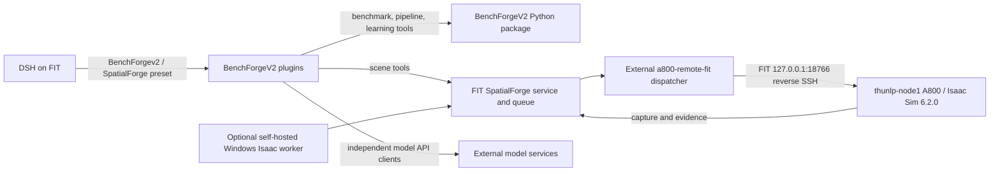

# BenchForgeV2

BenchForgeV2 is the maintained repository for the second-generation DSH mode,
SpatialForge integrations, composable benchmark pipelines, and spatial-learning
tools. New integration work belongs here; the official `deepseek-harness` source
is an external dependency and is not modified by this repository.

## Modes and deployment

The DSH preset names identify separate modes in the same deployment:

| Mode | Purpose | DSH profile binding |
| --- | --- | --- |
| `BenchForge` | Retained first-generation benchmark mode | Legacy mode |
| `BenchForgev2` | Second-generation published mode | `.deployment/published` on FIT |
| `SpatialForge` | Second-generation development mode with scene tools | Repository checkout on FIT |

The maintained FIT checkout is `/home/maqiang/GitHub/BenchForgeV2`, branch
`SpatialForge`; the public repository is
[EurecaMoment/BenchForgeV2](https://github.com/EurecaMoment/BenchForgeV2).
The active production simulation route is DSH on FIT → the FIT SpatialForge
service and queue → the external `a800-remote-fit` dispatcher → FIT's local
reverse-SSH endpoint `127.0.0.1:18766` → `thunlp-node1` running Isaac Sim 6.2.0
on A800 → capture and evidence returned to FIT. `desktop-isaac` is a retained
database lease name; it does not identify the active remote worker. The A800
dispatcher and its server-side Isaac deployment are outside this repository.



The Windows worker is a supported self-hosted deployment option, not the active
FIT production route. External model services, weights, simulator installations,
assets, credentials, and production artifacts remain in their own deployment
locations. The lightweight clients in this repository do not start or migrate
those services.

## What is included

- **Composable pipelines:** retrieve 89 user-defined tasks and 267 exact
  measurement-template variants from the 出题模板; interpret an objective into
  explicit template selections; run, resume, inspect and deterministically
  evaluate pipeline artifacts. Only 17 variants currently have built-in
  program generators. Other variants require official, program, or simulation
  evidence and task-specific adapters before they become production data.
- **Spatial learning:** a separate graph of 27 capability nodes, each with 120
  template specifications, plus program-grounded dataset generation, curriculum
  training, experiments, checkpointing and live training monitoring. See
  [Spatial learning](docs/spatial-learning.md).
- **SpatialForge:** reference/layout tools, scene programs, assets, model-service
  clients, capture/evidence review and data export. See the
  [SpatialForge integration guide](integrations/spatialforge/README.md).
- **DSH integration:** installable Node plugin bundles and preset builders. DSH
  source, external model startup code, model weights and simulator deployment
  are not vendored as BenchForgeV2 runtime services.

The capability graph and the 出题模板 catalog are different resources: the
27-node graph is not a relabeling of the 89-task/267-template catalog. Generated
records keep public questions separate from authority data; model predictions
do not become ground truth. Ground truth comes from official sources, task
programs or simulation.

## Local examples

Python 3.10+ can run the offline benchmark example without a model API or GPU:

```bash
git clone https://github.com/EurecaMoment/BenchForgeV2.git
cd BenchForgeV2
python benchforge.py demo
```

For a programmatic production example:

```bash
python -m pip install -e ".[production,research]"
python examples/production_demo.py --workspace runs/production
```

This draws and scores a small set of controlled examples. It is not an Isaac
scene-quality, model-training, or benchmark-approval result. The CPU learning
demo trains only a small controlled Transformer task:

```bash
python examples/spatial_learning_demo.py --workspace runs/cpu-training
```

## DSH setup

The simple launcher below builds a private DSH runtime and installs the retained
first-generation `BenchForge` mode for local use. It does not reproduce FIT's
current SpatialForge/A800 deployment:

```bash
python benchforge.py setup
python benchforge.py start
```

To attach the second-generation bundle to an existing DSH profile, follow
[integration installation and preset selection](integrations/README.md). To run
the bundled SpatialForge server and a self-hosted desktop worker, use the
[self-hosted installation guide](docs/SPATIALFORGE_INSTALL.md); it is an
alternative deployment, not a migration recipe for FIT's A800 worker.

## Tests and documentation

```bash
python -m unittest discover -s tests -v
python integrations/spatialforge/smoke.py
```

The SpatialForge smoke test checks its HTTP request contract and delivery-review
logic without starting Isaac or calling a target-model API. A passing local test
does not establish current remote service health.

- [Pipeline catalog and evidence requirements](docs/pipelines.md)
- [Spatial learning, training and monitoring](docs/spatial-learning.md)
- [Model-service client boundary](docs/MODEL_SERVICES.md)
- [Self-hosted SpatialForge install](docs/SPATIALFORGE_INSTALL.md)
- [Validation scope and history](docs/VALIDATION.md)
