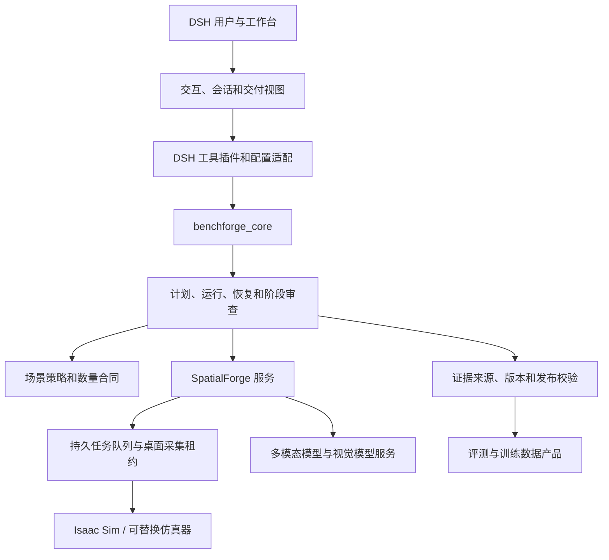

# BenchForgeV2 架构与演进路线

本项目有两条并行主线：一条建设可复用的 Harness 框架；另一条通过框架提供评测与训练数据服务，支持 RSI 模型迭代。服务产品复用框架，但保留独立的交付状态、证据标准和客户接口。

## 当前模块边界

| 边界 | 责任 | 关键约束 |
|---|---|---|
| 工作台与 DSH 插件 | 交互、工具发现、会话绑定、用户审查 | 插件通过服务/API调用能力；配置不能由 UI 偷改服务器策略 |
| `benchforge_core` | 可移植契约、流水线、评测、数据产品 | 核心包不依赖特定 DSH 部署、GPU 服务或仿真器 |
| SpatialForge | 场景请求、队列、模型编排、仿真采集与回执 | 服务端是运行身份、策略和任务状态的权威来源 |
| Provider adapters | 连接 VLM、小模型和仿真器 | 统一超时、取消、重试、能力声明和错误回执 |
| Evidence and delivery | 证据追溯、质量门、发布清单 | 模型预测不升级为真值；来源、采集和题目/答案的派生关系可追溯 |
| Evaluation and training service | 评测包、训练包、运行结果和报告 | 明确数量合同、数据划分、版本、缺项与交付状态 |

## 已具备的基础

- 冻结场景程序、采集回执、上传恢复与失败证据留存。
- DSH 工具集、可恢复流水线、阶段评审和本地空间学习工具。
- 公开题目与 authority 答案分离，发布包显式枚举公开资产。
- SpatialForge 任务队列、桌面 worker 租约与服务端场景策略。
- 独立的模型服务与仿真调用边界；本轮的 TRELLIS 服务性能优化仍作为 SpatialForge 能力的一部分。

这些能力不是完整生产认证。模型、GPU、仿真器和吞吐指标仍需在目标机器上测量并留存验收结果。

## 设计准则

1. 用版本化 schema 定义服务、任务、阶段、证据和交付回执。
2. 用明确适配器隔离 DSH、模型、Isaac Sim 和其他执行器；核心业务不直接拼接供应商协议。
3. 运行记录区分 `execution_status`、`delivery_status` 和 `quality_status`。执行成功不代表数量满足或质量通过。
4. 数量合同明确为 `exact`、`minimum` 或 `best_effort`，并记录目标数、实际数、短缺和失败原因。
5. 服务器配置、执行模式与场景策略只有一个权威来源。生产模式缺策略时失败关闭；探索模式必须明确。
6. 每个 run 有稳定身份、原子领取、幂等请求键、可恢复检查点、父子关系和取消传播边界。
7. 证据图记录 `source -> simulator state -> capture -> annotation -> question -> answer -> package` 的版本关系、工具版本、人工审查与校验结论。
8. 模型提出候选标注或题目，独立的确定性规则、真值源及人工门控决定是否接受。
9. 用有限预算、超时、批量、背压和并发限制控制吞吐；用端到端产物测试延迟，不用 health 或缓存命中代替生产测量。
10. 文档区分已实现、已验证、目标环境已验收和规划中；不以离线单测宣称生产成功。

## 演进计划

| 阶段 | Harness 框架主线 | 评测/训练服务主线 | 主要验收 |
|---|---|---|---|
| P0：规整与契约 | 统一配置、请求/回执、运行状态；拆分超大模块；补齐可发布包资源和 CI | 明确 exact/minimum/best-effort、部分交付与质量状态 | Windows/Linux 测试；干净安装；无本地配置、备份和临时产物入库 |
| P1：执行与证据 | 原子领取、run/attempt 身份、取消边界、子任务协议和断点恢复 | 固化真值到问题、答案和公开包的 lineage manifest | 杀进程/恢复测试；重复请求幂等；追溯任一答案到来源及生成版本 |
| P2：证据标注 | 模型适配器、批处理、超时重试、资源配额和标注 schema | 组合 Isaac Sim 真值、SAM/深度/分割等小模型候选，人工审查后形成标注产品 | 校准与遮挡/长尾测试；候选/权威标注分离；标注错误可回溯 |
| P3：生产工作流 | 增加持久工作流编排；评估 DSH Super Agent 作为交互式规划与修复层，不取代可靠执行器 | 场景采集、标注、题目编制、质量门、发布和重跑形成可观察流程 | 父子运行状态完整；失败可从检查点恢复；并发/取消/重试边界可测 |
| P4：驱动模型优化 | 建立多模态理解/生成模型统一接口、版本注册、成本与延迟遥测 | 用失败簇、审查反馈和独立验证集迭代理解与生成模型 | 每次模型变化通过固定基准和反捷径检查；保留旧版可比较、可回退 |
| P5：Infra 性能 | 队列调度、数据传输、模型并发、缓存、批处理和异构 GPU 配额 | 提供可预约的评测/数据生成吞吐 | 公开硬件/精度/缓存条件；端到端 P50/P95、吞吐、错误率及资源公平性 |
| P6：RSI 产品闭环 | 提供模型注册、评测协议版本、实验运行、结果对比及训练数据接口 | 对目标 RSI 模型重复评测、困难样本修复、训练集生成、重训与再评测 | 测试集隔离；跨版本独立基准；消融与回归；训练前后收益可复现 |

阶段可并行，但 P1 的运行和证据合同是 P2–P6 的依赖。Super Agent、模型自优化和 RSI 进化属于未来能力，不能代替具名负责人与确定性发布门。

## 人力建议

近期（P0–P2）建议保持约 5–7 名核心工程人员，按责任面配置：

- Harness/DSH 与工作流架构：1–2 人。
- SpatialForge 后端、队列、仿真集成：1–2 人。
- 证据/数据质量与标注算法：1–2 人。
- 前端工作台和开发体验：1 人。
- 测试、发布与性能工程：至少 1 人，可由上述岗位轮值但需明确 owner。

进入 P3–P6 后，再按 GPU/仿真平台、评测科学、模型训练和平台 SRE 拆分专职岗位。人数是工作计划建议，不是当前实现或已到岗人员的陈述。
