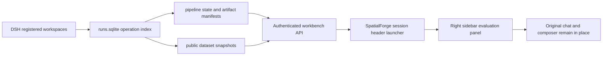

# BenchForgeV2 / SpatialForge 对话内评测环境

工作台代码位于 `integrations/spatialforge/ui`，通过 DSH 官方插件和 Slot API 接入；
不改 DSH 源码。UI 不占聊天主区域，也不增加全局导航项。它只在 `SpatialForge`
preset (`spatialforge-standard-ptc`) 的会话标题栏显示“评测集”入口。用户点击后，
评测工作台在该会话的右侧边栏打开，原 SpatialForge 对话记录、输入框和工具保持原位。UI 插件和读取 API 作为 SpatialForge preset 的子插件加载，不挂到 DSH 根 profile。

右侧面板是会话上下文的延伸：运行、数据集版本、样本浏览和质量报告都服务于当前
SpatialForge 会话。面板状态按 Session ID 保存，数据查询按该会话的工作目录限制到
对应 DSH 工作区；其他 preset 不会加载评测工作台，也没有入口。工作区缺失时 API 返回空结果，其他工作区数据不会混入列表。

## 产品取舍

保留直接帮助制造评测集的四个入口：

| 面板内入口 | 实际提供的功能 |
| --- | --- |
| 总览 | 最近运行、数据集目录、已记录 artifact 状态、索引来源和读取失败 |
| 运行与产物 | 步骤状态、冻结计划摘要、父产物、证据引用、合同结果和已保存修复建议 |
| 数据集 | 工作区与产物版本目录、服务端分页、模板/split/题目/ID 检索、网格与表格、公开样本和媒体 |
| 质量报告 | 所选版本的请求数、生成接纳数、缺口、场景组、模板覆盖和拒绝原因 |

谱系和修复是运行详情的一部分，样本审阅首先以数据集详情承载，避免创建多个重复、
空白的导航页。没有真实模型响应矩阵时不展示 IRT；没有发布凭据时不展示“已发布”；
生成完成、结构合同通过和生成接纳数量都不改写为“已验证”。

当前面板以读取和定位问题为目标。计划生成、启动/恢复运行、创建修复 proposal、
评分与打包继续使用已集成的 DSH 工具。界面没有伪造可写按钮或后台执行状态，
也不修改 GT、质量规则或原失败记录。

## 数据流



- 从 DSH `workspaceRegistry.list()` 取得工作区；额外目录通过插件配置 `workspacePaths` 明确加入。
- 每个工作区只查询最近 `maxRuns` 条相关操作（默认 60，上限 200），不递归扫描磁盘。
  截断和索引失败会显示在总览；统计范围是这些索引记录，不是机器上全部数据。
- pipeline 路径来自操作的 request/result；数据集路径来自已保存的 step result。
  使用规范路径检查，目录或媒体符号链接不能越过配置的工作区。
- artifact 统计只来自 `artifacts.jsonl`。没有 manifest 时返回 `null`，前端显示“—”。
- JSONL 流式读取；数据集服务端返回当前页，支持 24/48/96 条。目录路径用于隔离生产版本；
  这不等于已经冻结发布版本。不同目录的样本不会合并计数。
- 公开字段使用 allowlist。数据接口不读取 `authority.jsonl`、`sft.jsonl` 或私有 oracle；
  媒体只允许读取题目声明且位于 `media/` 下的公开图片。
- 模型预测仍是候选证据，GT 来自官方、程序或仿真。结构合同不证明场景或题目质量。
- 选中版本、筛选、页码和显示方式保存在 `localStorage` 中的 Session 专属键；不会写入
  页面 URL，也不会串到另一个会话。切换请求和组件卸载会取消未完成的读取。
- 每次面板请求都带当前 Session 的 `cwd`。服务端只返回工作目录与已登记 DSH 工作区
  根目录完全匹配的数据；没有匹配工作区时显示提示，不回退到全局数据列表。

## 接口

所有接口由 DSH Connection 的认证和 Host/Origin 检查保护：

| GET `/api/benchforge/workbench` 参数 | 返回 |
| --- | --- |
| `view=summary&workspace_path=<cwd>` | 当前会话工作区内的运行、数据集目录、artifact 统计和索引状态 |
| `view=run&run=<id>&workspace_path=<cwd>` | 当前工作区内的步骤、计划摘要、artifact manifest 和修复建议 |
| `view=dataset&dataset=<id>&workspace_path=<cwd>&page=1&page_size=24` | 当前版本公开样本和分页，可加 template/split/q |
| `view=media&dataset=<id>&workspace_path=<cwd>&item=<row>&media=<index>` | 当前工作区内题目声明的公开图片 |

浏览器不接收 SpatialForge operator token。DSH 认证 cookie 不保存进部署回执。
运行接口提供操作者使用的来源路径和合同信息；它不是对外考生评测服务。

## 热加载

在已运行的 FIT DSH 主机中，从本仓库执行：

```bash
python integrations/spatialforge/install_workbench.py
# 需要加入未登记到 DSH 的任务目录时：
python integrations/spatialforge/install_workbench.py --workspace /absolute/task-workspace
```

脚本只在用户 profile patch 中添加/更新一个根插件行，先备份配置，
验证认证 API、DSH client boot graph 和前端 bundle，并核对 DSH/SpatialForge PID 没有变化。
失败恢复原 profile。不会重启 DSH、模型或仿真器。

安装回执 `.deployment/workbench-install.json` 的 `browser_render_verified=false`
表示脚本只完成主机侧接入检查。真实浏览器的侧栏、渲染和数据浏览需要单独验收，
不能把该回执当作页面实际验收。

官方 DSH 源码保持不变；业务 UI、API 和安装脚本全部在 BenchForgeV2 内。
重启后的加载由用户 profile 保持，不依赖当前对话。

## 后续增补的条件

- 计划编辑与执行按钮：接入现有工具的写操作和真实 operation receipt 后再开放。
- 人工审阅：先实现持久化 review receipt，不能只在浏览器改变状态徽标。
- 冻结交付：先绑定实际 manifest、质量门和文件版本，不能仅由 completed 判断。
- IRT/模型诊断：先取得真实固定题集响应矩阵；与 GT 和发布门分开。

## 针对性验证

- `node --test integrations/spatialforge/tests/test_workbench.mjs`：
  真实 pipeline 生成的两个数据集、分页/检索/版本隔离、公开媒体、答案隔离、
  candidate/verified 边界、只读数据库、非法路径和官方 slot 注册生命周期。
- `python -m unittest discover -s integrations/tests -p test_workbench_install.py -v`：
  根插件安装幂等、不改其他模式、当前 DSH boot graph 格式。
- 本次整改后需再做一次 DSH 浏览器验收，确认普通 preset 不显示入口、SpatialForge
  会话标题栏按钮可打开右侧面板、原聊天与输入框仍在、会话工作区过滤和分页/媒体可用。
  旧版主区域入口的浏览器结果不能替代本次验收。
