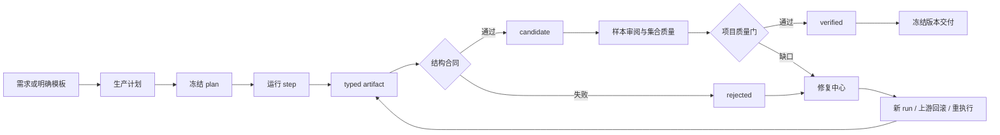

# BenchForgeV2 / SpatialForge 工作台 UI v2

状态：`featurexx` 设计基线

这份文档把原有七页工作台与 `featurexx` 新增的 typed artifact lineage、合同结果和 bounded repair 流程合并。它定义前端应该展示什么，不把演示数字、模型预测或聊天回复当作生产事实。

## 1. 产品对象

工作台围绕五种对象组织，而不是围绕一次对话组织：

| 对象 | 含义 | 用户要看到的结果 |
| --- | --- | --- |
| 项目 | 一个评测集或训练数据目标 | 目标、范围、当前阻塞、交付状态 |
| 计划 | 冻结的模板选择和 pipeline steps | 选择了哪些模板、数量、来源和分区 |
| 运行 | 一次可恢复的计划执行 | 每个 step 的输入、状态、输出和耗时 |
| 产物 | step 产生的 typed artifact | 类型、版本、父产物、证据、合同结果和状态 |
| 交付 | 绑定版本和样本清单的发布包 | 公开包、私有答案、质量报告和变更记录 |

DSH 对话助手只负责解释、起草和提出下一步；项目状态必须来自持久化运行记录、artifact manifest、合同结果和质量报告。

## 2. 统一导航

```
项目总览
  ├─ 生产计划
  ├─ 生产现场（运行详情）
  ├─ 产物谱系       新增
  ├─ 修复中心       新增
  ├─ 数据集全集
  ├─ 样本审阅
  ├─ 集合质量
  └─ 版本交付
```

路由建议：

| 页面 | 路由 | 来源 |
| --- | --- | --- |
| 项目总览 | `/projects/:projectId` | 原设计 |
| 生产计划 | `/projects/:projectId/plans/:planId` | 原设计 |
| 生产现场 | `/projects/:projectId/runs/:runId` | 原设计，增加 artifact 入口 |
| 产物谱系 | `/projects/:projectId/runs/:runId/artifacts` | 新增 |
| 修复中心 | `/projects/:projectId/repairs` | 新增 |
| 数据集全集 | `/projects/:projectId/datasets/:datasetId/versions/:versionId` | 原设计补强 |
| 样本审阅 | `/projects/:projectId/review` | 原设计 |
| 集合质量 | `/projects/:projectId/quality` | 原设计 |
| 版本交付 | `/projects/:projectId/releases` | 原设计 |

## 3. 端到端流程



`candidate` 表示步骤已完成且有结构化回执，不表示题目或评测集已经通过。只有 operation-specific verifier 和项目质量门都通过，才能显示 `verified`。

## 4. 页面定义

### 4.1 项目总览

保留原设计的项目状态、目标数量、已生成和待处理统计，但统计来源改为 artifact 状态和数据集快照：

- 顶部显示项目、当前数据集版本、快照时间和当前运行。
- 核心数字分开显示：`draft`、`candidate`、`verified`、`rejected`、`superseded`。
- “下一步”只列影响交付的真实事件，例如缺证据、合同失败、未完成运行和集合质量缺口。
- 每个事件直接跳转到对应 run、artifact 或 repair plan；不让用户在聊天记录中寻找原因。
- 演示数据必须带“演示”标识；真实服务没有统计时显示“未统计”，不能显示为零。

### 4.2 生产计划

保留能力 → 任务 → 模板的选择器，增加产物预期和证据要求：

- 每个 step 显示 `artifact_type`、输入证据、输出证据和是否需要终止状态。
- 计划预览显示 `templates.produce → scene.capture → evidence → data.package` 等顺序和分支。
- 计划冻结后显示版本和只读摘要；修改模板、数量、分区或输入时创建新 plan，不覆盖旧 plan。
- 计划页只负责生成/保存计划，不在前端直接启动模型或仿真器。
- 对没有内置生成器的模板，显示“需要官方/程序/仿真证据”，不能显示为“可直接生产”。

### 4.3 生产现场（运行详情）

生产现场仍是执行主页面，但每个 step 必须同时展示状态和产物：

- step 行：状态、运行时间、输入引用、输出 artifact、父产物数量和下一动作。
- 状态使用 `waiting`、`needs_input`、`needs_evidence`、`failed`、`completed`，不使用模糊的“处理中”。
- `completed` 行显示 `candidate`，并提供“查看产物”；`failed` 行显示“进入修复中心”。
- `waiting` 行显示实际等待的远端任务或证据，不提供虚假的“已取消”。
- 只允许恢复当前 run、补绑定、补来源或创建修复 run；不自动重写 GT、不自动放宽合同。
- 场景步骤使用“参考图 → SceneProgram → 资产 → 采集 → evidence”的可折叠流；程序题可隐藏仿真分支。

### 4.4 产物谱系（新增）

这是本轮新流程的主观察页，回答“这个结果从哪里来、经过什么检查、能否重放”。

页面布局：

1. 顶部过滤：运行、artifact type、状态、producer、版本。
2. 中部左侧为父子关系图，右侧为可分页记录表。
3. 下方为选中 artifact 的详情抽屉，不离开当前上下文。

表格字段：

| 字段 | 展示 |
| --- | --- |
| `artifact_id` | 可复制 ID，支持打开同 run 详情 |
| `artifact_type` | `scene.capture`、`benchmark.dataset` 等 |
| `version` | 同 step 的显式版本号 |
| `parents` | 父 artifact 数量和可展开链接 |
| `producer` | 产生它的 operation |
| `evidence_refs` | 只显示声明的来源路径，不在浏览器扫描文件 |
| `contract_results` | 通过、失败或 `not_applicable`，可展开检查项 |
| `status` | `draft/candidate/verified/rejected/superseded` |
| `result_path` | 服务端受控下载/查看入口 |

详情抽屉分四个 tab：`摘要`、`合同`、`来源`、`下游影响`。合同区必须注明“结构合同不等于 GT 或场景质量证明”。模型预测、估计深度和候选伪标注只能显示为 prediction/candidate evidence。

### 4.5 修复中心（新增）

修复中心按失败 artifact 聚合，而不是按聊天消息聚合：

- 队列列出失败原因、影响的下游数量、最近版本、来源和建议操作。
- 建议操作固定为：`local_field_repair`、`template_rebinding`、`candidate_resynthesis`、`skill_reexecution`、`upstream_rollback`、`final_rejection`。
- 操作详情显示“修改范围”和“不会修改的内容”：GT、验收规则、远端服务和原始失败证据均保持不变。
- `upstream_rollback` 展示受影响的下游 artifact；其他操作只显示当前 artifact。
- “创建修复 run”只生成一个新的 plan/run 草稿，携带原 artifact 和失败原因；用户确认后才执行。
- 修复计划状态为 `proposed`、`accepted`、`superseded` 或 `rejected`，不把“已提出”显示为“已修复”。
- 修复完成后回到产物谱系比较新旧版本，并保留原记录。

### 4.6 数据集全集

保留原设计的项目 → 数据集 → 版本 → 分类/筛选 → 分页样本层级：

- “全集”是当前数据集和版本中已生成的全部记录，包含待审和返工，不含尚未生成的目标数量。
- 过滤：能力、任务、模板、split、artifact 状态、审阅状态、搜索词。
- 网格用于媒体浏览，表格用于元数据核对；每页 24/48/96 条。
- URL 保存版本、筛选、排序、布局和页码；详情返回后保持位置。
- 服务端分页只返回当前页，原始深度、私有答案和大媒体按权限/按需加载。
- 数据集条目可直接打开关联 artifact、repair plan 和 release diff。

### 4.7 样本审阅

保留考生视角优先的审阅方式，并加入 artifact 来源条：

- 公开题面、实际观测、答案格式先展示；私有答案、oracle、来源和合同放在操作者区域。
- 每个观测显示 `official/program/simulation/prediction` 来源标签。
- 题面与媒体不符、信息不足、坐标/单位冲突、绑定错误和媒体缺失都生成可定位的失败原因。
- 审阅动作写入样本版本或 review receipt，不直接把样本改成 verified。
- “查看来源”打开 artifact 详情；“建议修复”进入修复中心并带入样本上下文。

### 4.8 集合质量

把单题审阅和集合质量分开：

- 覆盖率：模板、能力、split、来源世界和场景族。
- 多样性：视角、遮挡、资产、布局、光照、答案分布和媒体重复。
- 有效性：公开信息可回答、无答案泄漏、GT 来源合法、交互有终止条件。
- 每个诊断均可下钻到样本和 artifact；报告“观测到的分布”和“项目规则是否通过”。
- 质量缺口生成补采计划，不重跑不受影响的上游产物。
- IRT、典型模型评测和模型响应只作为诊断面板，不能替代程序/官方/仿真 GT 或发布门。

### 4.9 版本交付

交付页绑定 plan、run、artifact manifest、模板协议、分区、质量报告和样本清单：

- 公开题目/媒体、私有答案/来源、可选训练包分开显示。
- 冻结前显示未验证 artifact、rejected artifact、修复计划和集合质量缺口。
- 版本 diff 显示新增、删除、替换、协议变更和分区变更。
- 导出前显示实际体积、已计入项和未计入项；不把预计 100 GB 当作实际占用。
- 只有真实质量门通过且 manifest 冻结后，才显示“可交付”。

## 5. 共享组件

| 组件 | 规则 |
| --- | --- |
| 状态徽标 | 固定颜色和文字映射；`candidate` 不使用“通过”文案 |
| Artifact chip | 显示类型、版本和状态，可打开详情 |
| Contract panel | 显示检查项、错误和“结构检查边界” |
| Evidence drawer | 路径、来源类型、公开/私有权限和引用关系 |
| Run step row | 输入、输出、等待原因、恢复入口和实际时间 |
| Repair action | 只创建 proposal 或新 run，不在浏览器直接改 GT |
| Snapshot bar | 数据集快照时间、版本和刷新入口 |
| DSH context | 当前项目/页面/样本/证据上下文，私有答案默认不注入 |

## 6. 前端与现有工具的映射

前端需要一个薄 BFF/API 适配层，不能把 DSH CLI 输出直接当作浏览器 API：

| UI 操作 | 现有能力 | 读/写 |
| --- | --- | --- |
| 查模板和协议 | `pipeline_catalog` | 读 |
| 起草计划 | `pipeline_plan` | 写计划 |
| 启动/恢复运行 | `pipeline_run` | 写运行 |
| 查看步骤状态 | `pipeline_status` | 读 |
| 查看产物谱系 | `pipeline_artifacts` | 读 |
| 生成修复建议 | `pipeline_repair_plan` | 写 proposal |
| 确定性评分 | `pipeline_evaluate` | 读/生成报告 |
| 场景证据 | SpatialForge capture/status/evidence 客户端 | 服务端代理 |

现有工具是入口和语义合同，不等于已经存在 REST 页面接口。BFF 负责分页、权限、媒体缩略图、SSE/轮询和 URL 状态持久化。

## 7. 权限和信息隔离

- 考生视角只能得到 public question/media/conditions。
- 操作者视角才能读取 authority、GT、私有来源和 repair reason 的内部字段。
- DSH 助手只接收当前页面允许公开的上下文；浏览器切换视角不能替代服务端权限校验。
- 模型预测、Qwen/SAM/深度/3D 估计结果保留 prediction 或 candidate evidence 标签。
- GT 只允许来自官方、程序或仿真；UI 不提供“采纳模型结果为 GT”的按钮。

## 8. 响应式和状态行为

- 桌面端：左侧导航、主表格、右侧详情抽屉；产物谱系图在宽屏显示。
- 平板端：导航折叠，详情抽屉变为底部面板，表格保留关键列。
- 手机端：导航横向滚动，所有列表变为单列，状态、ID、下一动作置顶；不把长 artifact ID 作为布局宽度约束。
- 页面刷新后从服务端恢复当前 run、dataset snapshot、筛选和页码；不得依赖对话上下文保持状态。
- 轮询只更新当前 run 和快照，失败状态不会自动消失；事件推送可后续用 SSE 替换。

## 9. 分阶段落地

1. **第一阶段**：项目总览、生产现场、产物谱系、修复中心、数据集全集。先打通 artifact/status/repair 读取和 URL 状态。
2. **第二阶段**：生产计划、样本审阅、确定性合同和 review receipt 写回。
3. **第三阶段**：集合质量、版本 diff、冻结交付和大媒体按需加载。
4. **第四阶段**：SSE、资源适配器、典型模型诊断和 IRT 辅助面板；这些不作为第一版发布门。

## 10. 验收标准

- 从任意失败 step 可以在两次点击内进入对应 artifact 和 repair plan。
- 任意 artifact 都能看到 producer、版本、父产物、证据引用、合同结果和当前状态。
- waiting/needs_input/needs_evidence/failed/completed 在刷新后保持一致。
- 修复中心只能创建 proposal 或新 run，不能修改 GT、验收规则或远端服务。
- 数据集版本、分页、筛选和详情返回不会混合版本或丢失页码。
- public/authority/private 字段在服务端隔离；前端没有答案泄漏路径。
- UI 数字均能回指数据集快照、artifact manifest 或质量报告；没有证据时显示“未统计”。

当前草图中的数量、媒体和状态仍是演示数据；需要接入真实 BFF 和实际运行产物后，才能进行生产 UI 验收。
