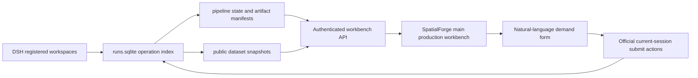

# BenchForgeV2 / SpatialForge 评测生产工作台

工作台代码位于 `integrations/spatialforge/ui`，通过 DSH 官方插件和 Slot API 接入；
不改 DSH 源码。选择 `SpatialForge` preset (`spatialforge-standard-ptc`) 的会话后，
工作台通过 `main.conversation` 接管该会话主视图，隐藏原聊天记录和 composer，
直接显示生产需求、执行反馈和五阶段产物。无需先打开右侧“评测集”面板。
此替换严格限定于 SpatialForge；其他 preset 保持原来的对话界面。

工作台继续使用当前 DSH 会话执行任务：运行、数据集版本、样本浏览和质量报告都服务于当前
SpatialForge 会话。界面状态按 Session ID 保存，数据查询按该会话的工作目录限制到
对应 DSH 工作区，并按真实 `session_id` 精确关联生产记录；相同工作目录下的不同对话也互相隔离。工作区缺失或旧记录没有会话关联时显示空状态，不自动选历史运行。

## 使用流程

1. 在 DSH 中选择或新建 SpatialForge 会话，并选择有写权限的工作区。
2. 等待“完全权限已开启”。界面通过官方会话命令 `/permission danger-full-access`
   设置本会话权限，不把该命令发给模型；权限投影就绪前不允许提交生产。
   失败时显示原因和“重试开启权限”。
3. 在常驻的“数据集生产需求”表单输入自然语言，填写“目标题量”。默认 `100`
   只是请求目标，不是已生成数量。能力或模板要求可留空，由 DSH 按现有能力图谱拆解；
   “高级选项”中的目标场景数和存储上限也可留空。
4. 点击“开始生产”，一次提交完整五阶段要求，DSH 随后调用已接入的工具实际执行。
   页面不要求另到聊天输入框发送。若原 composer 留有草稿或附件，先查看展示的内容，
   必须显式勾选一并发送才可提交；未勾选时它们保持不变。
5. 在五阶段查看实际计划、场景、标注、题目和报告；顶部跟随当前执行状态，
   “最新执行反馈”展示最近的助手文字。需要调整时使用“追加要求”或阶段底部的
   “提出修改要求”。执行中的追加要求进入当前会话消息队列。

“停止当前执行”取消当前助手 turn，不代表取消全部已提交后台任务或排队要求；
这些任务仍以各自回执为准。“新建生产任务”切换需求表单模式，不创建新 DSH 会话。
五阶段导航和“上一步／下一步”只切换查看位置，不触发重复生产。

## 产品取舍

五阶段是唯一页面导航，具体设计见 [五阶段工作台](five-step-workbench.md)：

| 阶段 | 实际提供的功能 |
| --- | --- |
| 评测计划 | 当前对话已落盘的计划；本对话运行历史；折叠的只读模板参考 |
| 场景预览 | 已生成的场景图像和视频预览 |
| 标注预览 | 公开标注、标定和对应图像 |
| 评测配置与题目表 | 当前生产运行的数据集版本、筛选分页、样本和媒体 |
| 最终报告 | 正式报告、集合质量和诊断附件 |

顶部直接订阅 DSH 原生对话状态和消息队列，不用历史 Pipeline 状态替代对话状态。
新对话的生产目标默认 `100` 条，场景数和预算留空；没有预填的计划或产物。
产物区域只用于查看。阶段底部“提出修改要求”打开独立输入框，用户填写后
“确认发送”通过原生接口直接提交，不自动打包产物，也不要求再点一次发送。
已有草稿和附件同样需要显式勾选包含。

谱系和修复是运行详情的一部分，样本审阅首先以数据集详情承载，避免创建多个重复、
空白的导航页。没有真实模型响应矩阵时不展示 IRT；没有发布凭据时不展示“已发布”；
生成完成、结构合同通过和生成接纳数量都不改写为“已验证”。

工作台将自然语言要求提交给当前 DSH 会话；计划生成、启动/恢复运行、创建修复
proposal、评分与打包由已集成的 DSH 工具执行。它不是独立调度器，提交成功也不
代表生产完成。界面从真实回执和产物读取状态，不修改 GT、质量规则或原失败记录。

## 数据流



- 从 DSH `workspaceRegistry.list()` 取得工作区；额外目录通过插件配置 `workspacePaths` 明确加入。
- 每个工作区只查询最近 `maxRuns` 条相关操作（默认 60，上限 200），不递归扫描磁盘。
  截断和索引失败会显示在总览；统计范围是这些索引记录，不是机器上全部数据。
- pipeline 路径来自操作的 request/result；数据集路径来自已保存的 step result。
  使用规范路径检查，目录或媒体符号链接不能越过配置的工作区。
- artifact 统计只来自 `artifacts.jsonl`。没有 manifest 时返回 `null`，前端显示“—”。
- JSONL 流式读取；数据集服务端返回当前页，支持 24/48/96 条。目录路径用于隔离生产版本；
  这不等于已经冻结发布版本。不同目录的样本不会合并计数。
- 公开字段使用 allowlist。数据接口不读取 `authority.jsonl`、`sft.jsonl` 或私有 oracle；
  媒体只允许读取题目声明且位于 `media/` 下的公开图片。
- 模型预测仍是候选证据，GT 来自官方、程序或仿真。结构合同不证明场景或题目质量。
- 选中版本、筛选、页码和显示方式保存在 `localStorage` 中的 Session 专属键；不会写入
  页面 URL，也不会串到另一个会话。切换请求和组件卸载会取消未完成的读取。
- 每次产物请求都带当前 Session 的 `cwd` 和 `session_id`。工具桥接层保存实际 DSH
  会话关联；服务端同时限制工作区与会话，包含运行、数据集和媒体直链。没有匹配时不回退全局数据。

## 接口

所有接口由 DSH Connection 的认证和 Host/Origin 检查保护：

| GET `/api/benchforge/workbench` 参数 | 返回 |
| --- | --- |
| `view=summary&workspace_path=<cwd>&session_id=<sid>` | 当前对话计划、运行、数据集和索引状态 |
| `view=run&run=<id>&workspace_path=<cwd>&session_id=<sid>` | 当前对话步骤、计划、artifact 和修复建议 |
| `view=dataset&dataset=<id>&workspace_path=<cwd>&session_id=<sid>&page=1&page_size=24` | 当前版本公开样本和分页，可加 template/split/q |
| `view=media&dataset=<id>&workspace_path=<cwd>&session_id=<sid>&item=<row>&media=<index>` | 当前对话题目声明的公开图片 |

浏览器不接收 SpatialForge operator token。DSH 认证 cookie 不保存进部署回执。
运行接口提供操作者使用的来源路径和合同信息；它不是对外考生评测服务。

## 热加载

在已运行的 FIT DSH 主机中，从本仓库执行：

```bash
python integrations/spatialforge/install_workbench.py
# 需要加入未登记到 DSH 的任务目录时：
python integrations/spatialforge/install_workbench.py --workspace /absolute/task-workspace
```

脚本只在用户 profile patch 中添加/更新一个根插件行，先备份配置，
验证认证 API、DSH client boot graph 和前端 bundle，并核对 DSH/SpatialForge PID 没有变化。
失败恢复原 profile。不会重启 DSH、模型或仿真器。

安装回执 `.deployment/workbench-install.json` 的 `browser_render_verified=false`
表示脚本只完成主机侧接入检查。真实浏览器的主视图、渲染和数据浏览需要单独验收，
不能把该回执当作页面实际验收。

官方 DSH 源码保持不变；业务 UI、API 和安装脚本全部在 BenchForgeV2 内。
重启后的加载由用户 profile 保持，不依赖当前对话。

## 后续增补的条件

- 结构化计划编辑：须接入现有工具的写操作和真实 operation receipt；当前通过自然语言要求执行和修改。
- 人工审阅：先实现持久化 review receipt，不能只在浏览器改变状态徽标。
- 冻结交付：先绑定实际 manifest、质量门和文件版本，不能仅由 completed 判断。
- IRT/模型诊断：先取得真实固定题集响应矩阵；与 GT 和发布门分开。

## 针对性验证

当前对话区默认展开执行反馈：提交时立即显示本次要求，随后显示官方
`chat.legacy.partial` 的流式可见正文，以及工具准备、执行和实际返回记录。
工作台挂载时通过公开 `uiConversation.binding(sessionId).activate('chat')`
激活此数据源，不依赖用户上次保存的原生 view 标签。
反馈按最近的人类要求关联，旧轮回复和错误不混入新要求；不展示 reasoning。
工具的后台标准输出没有通用 conversation 流接口，此处展示工具生命周期与返回，
场景和 pipeline 的长期进度继续由五阶段生产回执更新。

同一会话的 `agentPreset` 投影暂时未就绪时保留已确认的 SpatialForge 主视图，
明确切换环境或会话后才移除；输入表单本身不注册或卸载主槽。

- `node --test integrations/spatialforge/tests/test_workbench_feedback.mjs`：
  流式正文、当前要求、提交回显和 PTC 工具状态的定向验证。

- `node --test integrations/spatialforge/tests/test_workbench.mjs`：
  真实 pipeline 生成的两个数据集、分页/检索/版本隔离、公开媒体、答案隔离、
  candidate/verified 边界、只读数据库、非法路径和官方 slot 注册生命周期。
- `python -m unittest discover -s integrations/tests -p test_workbench_install.py -v`：
  根插件安装幂等、不改其他模式、当前 DSH boot graph 格式。
- 本次主视图改造需单独做 DSH 浏览器验收：普通 preset 保持原对话；SpatialForge
  显示生产表单和五阶段并隐藏原聊天/composer；权限就绪才可提交；一键生产、
  草稿/附件显式确认、追加要求、停止当前 turn、会话隔离和分页/媒体均符合上述行为。
  旧版右侧面板验收结果不能替代本次验收。本文件描述实现流程，不表示目标部署已经通过验收。
